# Architecture: AI Call Center Agent for Meridian Home Comfort

## Summary

**The problem.** Meridian Home Comfort, a fictional heating, cooling and plumbing company in the Austin area, cannot keep up with its calls. The challenge (`docs/PRD.md`) is to build, in four working days, a chat agent at a public web address that answers routine calls from the company's documents, reads callers' accounts, books and changes appointments in a provided SQLite database, hands everything else to a human with full context, and proves its performance with numbers measured on held-out data.

**The approach.** One Python web application on one always-on Fly.io machine. Every caller message passes through a fixed pipeline: a safety check written in code, a fast AI router (Claude Haiku 5.5) that picks a flow, and a flow whose rules are enforced in code (knowledge answers from document search, read-only account lookups, booking changes in database transactions, and handoff tickets). Claude Sonnet 5.5 only writes the wording of replies, and every sentence is checked in code before it reaches the screen. A separate operations database records every conversation, ticket, cost and error, feeds the staff view and alerts, and is never touched by the nightly reset of the scheduling data. Offline tools, run on the author's laptop, sort the transcripts, build the search index, run the simulated-caller test set and grade answers through Codex.

**Where the project stands.** The intent (`docs/DESIGN.md`), the specification (`docs/SPEC.md`, 86 numbered requirements), this architecture and the plan (`docs/PLAN.md`) are approved, with the decisions recorded in `docs/DECISIONS.md`; the technology stack is its own decision (technology stack (D35)). Milestones 1 to 4 of 6 are built (foundations, search and test set, agent core, evaluation harness): configuration and the agent-core interface, transcript templates and labels, the findings document (`docs/FINDINGS.md`) and the prepared documents; then section-based keyword and meaning search, the frozen working and held-out test cases, and the standalone retrieval results; then the agent core: identification and account lookups, slot eligibility and booking transactions, the safety check, the operations store, the knowledge, account, scheduling and handoff flows, the router and the engine pipeline, with a terminal chat (`python -m app.cli`); then the evaluation harness: the simulated-caller test run graded by Codex and database checks, the quick test run, the threshold curve, the adversarial runner, the grader check and the agent freeze. Milestone 5 (website and deployment) is built and deployed on Fly.io: the chat page, sentence stream and visitor cookie, the spending budgets and reviewer link, the Staff view with receipts and flagging, the Results tab, the nightly reset, log purge, alerts and health check, and the deployment with its rollback runbook. Milestone 6 (final measurement and deliverables) is built: the one held-out measurement was run on the frozen agent (freeze hash `5b8f6899`) and its numbers are published in `data/results/final/summary.json`, on the Results tab and in the README, with the optional consistency runs, the results by call reason and the README.

The live build is not exactly the measured agent. After the measurement, the author allowed fixes to the live demo that the frozen agent did not have, with the held-out numbers left as measured (live fixes after the measurement (D51)); the agent-behaviour files therefore no longer match the freeze hash, so the final-run commands now refuse to run. The live fixes are:
- after any safety reply, the agent never books, reschedules or offers slots in that conversation, and points to the emergency ticket instead (a "yes" straight after the safety reply books nothing);
- a question that only asks today's date or time is answered with the demo's fixed date and time ("For this demo, today is Friday 16 October 2026 ..."), except while a booking offer or read-back is open, where "what time?" asks about the offer;
- a caller who gives their details in the same message as an emergency, or with a "yes" after the safety reply, is identified then, so the priority ticket carries their details and they are not asked again;
- the code-only money pre-check sends to the model check any sentence that names a plan with a benefit outside that plan's published list (the Plus-only water heater flush and whole-home plumbing inspection said of Standard, or "including plumbing" after the repair discount), or names both plans before one price;
- a promise that names the open ticket passes the follow-up rule only when it restates that ticket's own promise ("within one business day" or "as a priority"); any call or other time ("within 10 minutes about Ticket #3") is blocked;
- a model call is refused before it is made once the visitor's budget is spent, and a writer stream closed early (a blocked sentence, the deadline) still reports what it used;
- in the web layer: safety comes before the message limits; refused and blank messages write nothing; an accepted message is saved at once; every fallback reply opens an error ticket; a timed-out turn never acts later; the staff form token is never masked; the staff panel polls only while open; and only the final summaries ship in the image (each described below).

## 1. System overview

The system has three kinds of user (the reviewer or a caller, the author, and staff using the shared password), one web application, two databases on one disk, three outside AI services, and an offline toolkit on the author's laptop.

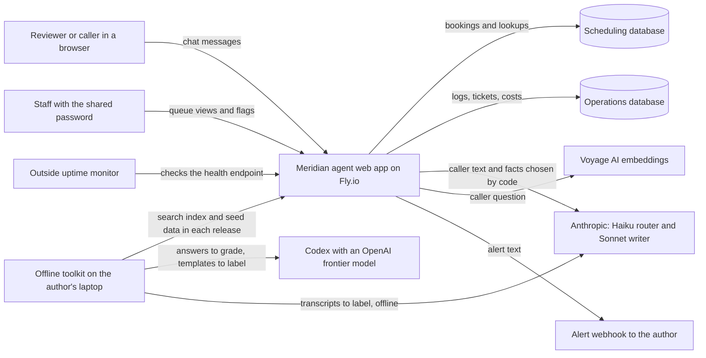

*The browser talks only to the web app; the app owns both databases and calls the AI services; the laptop toolkit prepares data and grades results offline; an outside monitor alerts the author if the app stops answering.*

## 2. Main parts

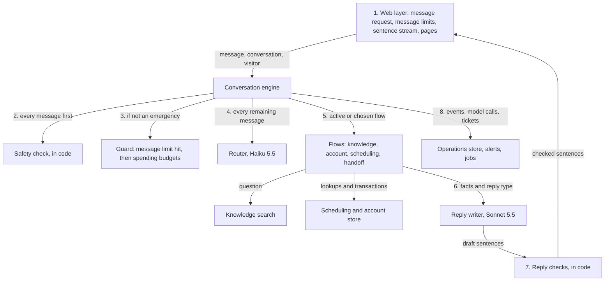

*Each message passes the numbered steps in order; the two AI models only choose a route and write wording, and code decides everything else.*

1. The browser sends each message as an ordinary request; the web layer checks that the conversation belongs to the signed visitor and opens a stream for that message's sentences. The same message id sent twice, even across a restart, gets one reply. A blank message gets "Could you tell me a bit more?" with no engine call, no limit counted and nothing written. Text past 2,000 characters is cut before the engine sees it, and the reply starts by saying so. The web layer counts the message against the message limits as it arrives (section 7). A message over a limit gets the limit message straight away, with nothing written, only when the agent's own safety check, run on the same history, finds nothing in it; one that reports a danger goes on to the agent with the limit it hit. Over the limits, an emergency reaches the agent and opens its own ticket only a few times a day per visitor and per network block (a /24 for IPv4, a /64 for IPv6), so rotating addresses does not help; a visitor past its own allowance gets the fixed safety advice from memory, with no ticket; a different visitor in a used-up block, or anyone past a site-wide ceiling of 100 a day, still gets the advice and the report is added to one merged emergency ticket for the day (up to 50 reports, the rest counted), with one alert to staff, so no other caller's report is dropped. IPv4 addresses written in IPv6 form count by their IPv4 block, and the day's merged ticket is remembered only once it exists (`app/web/limits.py` `allow_safety`). An engine run that stops without a done event still ends with the plain error message and no ticket; the web layer's fallbacks cover the stream timeout, a restart and an engine that raises. An accepted message is saved at once (an empty placeholder caller message and an "accepted" event holding its masked text), before it is handed to a reply thread, so a restart in between replays it as an unfinished reply.
2. The safety check runs first on every message, even mid-flow, even over a message limit and even for a visitor over budget; an emergency gets its fixed reply, which costs nothing.
3. Only then does the pipeline ask its guard, which refuses the message if it hit a message limit, or else if a spending budget is spent (section 4.2); a refusal gets a plain limit message. Within the turn, every model call is checked against the budget again just before it is made, so a turn that crosses the cap makes no further calls.
4. Some messages are answered in code without routing. A question that only asks today's date or time gets the demo's fixed date and time, unless a booking offer or read-back is open. After a safety reply, a short "yes" (to a booking the safety report abandoned) books nothing: it gets a fixed reply pointing to the emergency ticket and is added to it. A goodbye ("no, that's it", or "that's all" with nothing else and no question) ends the chat, even with a flow open (at a read-back only "bye" does). A filler line ("hold on", "you cut out") with nothing else in it gets a repeat of the open offer or read-back, or "No problem, take your time." With nothing in progress, a bare acknowledgement ("ok", "thanks") gets a plain "anything else?". A caller who gives their details on any route is identified then, and an open ticket gets the caller's name. The router runs on every message that reaches it. It splits a message into its requests, each with a route, a detail (such as balance, book or dispute) and a service type. With no flow active, the routes pick the flows; with a flow active, its result is used only to detect a clear change of topic, which includes a different scheduling action (booking, then cancelling another appointment) only when the message uses that action's verb ("cancel", "move" or "change", "book"). A code backstop (`app/core/language.py`) hands off a message in another language, with the English note "I can only help in English" (reply to another language (D47)), and hands off nonsense when no flow is open. An unclear, calm message of up to 15 words that asks nothing ("okay, good to know") gets "anything else?" instead of a ticket (or is added to the open ticket); a request for a person is still handed off.
5. The active or chosen flows run their code-owned steps. Account and scheduling requests wait together for the caller to be identified, then run in turn; a message naming a different customer switches the conversation to that account and drops the previous customer's booking in progress. Every handoff in one message goes into one ticket; a later handoff in the same conversation joins the open ticket, adding its reason tag and, for a dispute or billing review, the invoice notes. A handoff message asks an unidentified caller for their name and account number, phone or address. "Sign me up" or "add it" after the plan was discussed is a request to join, an action the agent cannot take. A booking request that claims a warranty also gets the coverage answer. The router decides requests to act on money or membership; a code backstop catches only requests that are never questions ("send me a payment link", "set up autopay", "cancel my membership", "I want to pay my bill") on every route except a handoff (R48, D43). A question about the service address, or a message saying it changed, is answered by the account flow in fixed text whatever the router called it: visits go to the service address on the account, and the agent never reads street addresses aloud; a changed address (or a street that differs from the one on file, compared but never said) is handed to a team member with the "address change" tag. Once a safety reply has been given in the conversation, any booking, rescheduling or slot offer is dropped from the message, with a fixed reply pointing to the emergency ticket; other requests still run.
6. The flow hands the writer the facts and a reply type.
7. Each sentence is checked before release. If a sentence fails, generation stops, the sentences already shown stay, the rest becomes a handoff message with a ticket, and a "blocked sentence" event is logged. Once the conversation has mentioned a burning smell, breaker-reset advice is blocked too.
8. Every step records events and model calls in the operations store. The writer always writes in English. One 15-second deadline covers the whole message: the router and writer calls get only the time left, and each booking change checks it just before committing, so nothing is committed after the caller has been told it was passed on.

The engine guarantees exactly one done event, always last. If the pipeline raises (for example, the operations database is unavailable, so no ticket can be saved), the engine releases a plain message asking the caller to phone the office, logs the failure to the server log and ends with an "error" done event; if the pipeline stops without a done event, it releases a plain handoff message and ends with "incomplete" (the engine opens no ticket on this path). A message for a conversation that belongs to another visitor gets a plain refusal ("forbidden"), and one for a closed or abandoned conversation asks the caller to start a new one, unless it reports a danger, which reopens the conversation for the safety reply.

The web layer has its own fallbacks around the engine, and each opens one "error" handoff ticket holding the caller's message (and the caller, if identified), logs an "error" event and shows "I couldn't finish that just now, so I'm passing it to a team member to follow up" (or, if the ticket cannot be saved, the phone-the-office message). They cover: the stream giving up after 40 seconds; a reply left unfinished by a restart, found when the browser reconnects; and the engine itself raising. Replies run in a pool of four threads, one message at a time per conversation, each holding the reset gate shared. A turn the stream has given up on never starts, and a turn starts only while the whole 15-second message deadline still fits before the stream would give up, so nothing it does lands after the caller was told it was passed on.

| Part | What it does | Where its rules come from |
|---|---|---|
| Web layer | Serves the Chat tab, Results tab and Staff view; takes each message as a request and streams its checked sentences back; holds the visitor cookie; checks conversation ownership on every request; counts the message limits; opens an error ticket for every fallback reply | Web pages (R64 to R72), guards (R62) |
| Conversation engine | Keeps conversation state, runs the pipeline, keeps a flow active across follow-up messages | Conversation state (R40), conversation lifetime (R82) |
| Safety check | Matches emergency patterns in code before anything else and returns fixed replies | Safety classes (R34 to R37) |
| Router | Haiku 5.5 returns a route and "clear" or "unclear" | Router (R38, R39), routing model (D25) |
| Knowledge search | Combined keyword and meaning-based search over current documents: the top result of each list is always kept (keyword search's only when some word matches), then the top 10 of each list are merged by reciprocal-rank fusion; five results returned (combined search keeps each list's top result (D41)) | Document search (R24 to R32) |
| Scheduling and account store | Read-only lookups and booking transactions on the scheduling database | Booking rules (R45 to R56), data rules (D29) |
| Reply writer | Sonnet 5.5 turns facts chosen by code into wording, as structured reply types | Pricing and internal-text rules (R42, R43) |
| Reply checks | Checks every sentence before release: in code, firm totals, waitlist promises, breaker advice after a burning smell, internal text (eight words in a row from an internal document) and promises that a team member will follow up (an offer to pass it on is allowed, and so is a sentence naming the open ticket that only restates its own promise, "within one business day" or "as a priority"); then every sentence that mentions money goes to a Haiku 5.5 check against the published money terms and the sentence before it, failing closed (money promises checked by a model (D43)); blocks are logged and counted | Sentence release (R60) |
| Spending and message limits | Per-visitor, site-wide and reviewer-reserve budgets, checked by the pipeline's guard after safety and again before each model call (`app/ops/spend.py`); message limits per visitor, per address and site-wide, counted in memory by the web layer (`app/web/limits.py`) | Guards (R61, R62), spending budgets with a reviewer reserve (D30), reviewer-only chat (D50) |
| Operations store | Logs, tickets, receipts, metrics, alerts, nightly reset, log purge | Monitoring and operations (R73 to R77), retention (D31) |

## 3. Technology choices

| Choice | What we use | Why |
|---|---|---|
| Language | Python 3.12 | Strong AI and data libraries; the author's choice. |
| Web framework | FastAPI with one worker process | Simple, async, built-in support for streaming responses. One worker keeps the in-app scheduler and its lock simple. |
| Message and streaming | Each caller message is an ordinary request carrying the conversation id and a message id; the engine yields typed events (one per checked sentence, then a done event with route, ticket, receipt, outcome and database actions); each released sentence is saved, and the server-sent-event stream for that message id replays saved sentences on reconnect; a message left unfinished by a restart (even one accepted but not yet started) becomes a handoff with an error ticket | The browser sends with a normal request and only needs to receive sentences as they are released; simpler than a two-way socket. |
| Pages | Server-rendered HTML with a little plain JavaScript | Three small pages; no front-end build step to maintain. |
| Databases | SQLite, two files, write-ahead logging mode | The provided database is SQLite; write-ahead logging lets reads continue during writes. |
| Search index | Built offline, shipped in each release as files (chunks and embeddings); the keyword index is rebuilt from the chunks at startup | The customer-facing documents are under 3,000 tokens, so the index is tiny; shipping it in the release makes rollback restore it too. |
| Scheduler and reset gate | A background task in the app plus an app-wide gate: every message holds it shared, the nightly reset holds it exclusively | One machine and one worker, so an in-process gate is enough to make messages wait during a reset; the job-runs table catches a missed reset at startup. |
| Alerts | A webhook URL setting (for example a push-notification service), plus a free outside uptime monitor on the health endpoint | One HTTP call per alert; the app cannot alert while it is down, so downtime is detected from outside (booking, reviewer-link and downtime protections (D34)). |
| AI SDKs and timeouts | Official Anthropic and Voyage Python SDKs, versions pinned; timeouts of 20 seconds for Anthropic, 5 for Voyage and 5 for the alert webhook, and a 15-second deadline per message after which it hands off; router and money-check attempts each get half the time left (one retry), and the streamed writer gets all of it, since a stream cannot be retried part-way. A reply sentence about money waits about half a second more for its Haiku check | Model IDs `claude-sonnet-5-5` and `claude-haiku-5-5`, the embedding model `voyage-4`, and settings pinned and logged with every run. |
| Offline grading | `codex exec` with a JSON output format | Uses the author's subscription, no API cost (grading through Codex (D15)). |

Skipped sections: caching, message queues and scaling do not apply to one small machine with demo traffic; the per-visitor and site-wide limits are the only capacity controls needed.

## 4. Databases

### 4.1 Scheduling database (provided, reset nightly)

The provided SQLite file, used exactly as given. A read-only **seed copy** of the original file ships in each release: the nightly reset restores from it, and cancellations read it to restore a freed slot's status, because the live tables do not record whether a booked slot was originally members-only. If the seed copy shows the slot as open or members-only, that status is restored; if the seed copy itself shows it as booked (a seeded appointment, such as Linda Foster's on 22 October), the slot is freed to open, as the schema's "free the old slot (open)" rule says (freed-slot fallback (D33)).

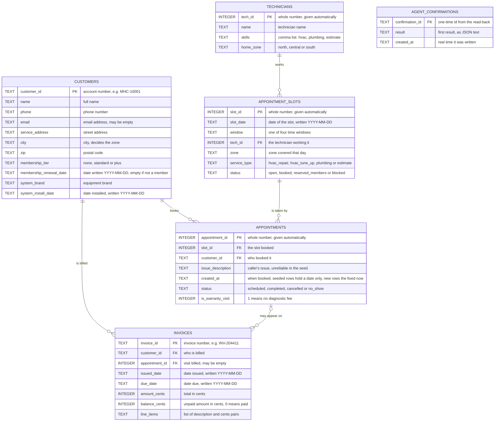

*The five provided tables, plus the agent's confirmations table: customers book appointments in technicians' slots and receive invoices; each booking change stores its first result under its confirmation id.*

How the tables link, in words: each appointment belongs to exactly one customer and takes exactly one slot; each slot belongs to exactly one technician and may have several appointments over time (cancelled ones stay as history) but at most one with status scheduled, which the booking code enforces inside its transaction because the provided database has no such rule; each invoice belongs to exactly one customer and may refer to one appointment (its appointment id may be empty, and nothing stops two invoices naming the same appointment). The agent writes only to `appointment_slots.status`, `appointments`, and one small table it adds, `agent_confirmations` (confirmation id, result, time), which is written in the same transaction as each booking change so a repeated "yes" can never book twice; the provided tables are untouched and the nightly reset recreates `agent_confirmations` empty (architecture refinements (D36)). It never writes customers or invoices.

One made-up example row per table:

| Table | Example row |
|---|---|
| customers | MHC-10001 · Linda Foster · 512-555-0101 · linda@example.com · 12 Elm St · Round Rock · 78664 · standard · 2026-11-20 · Carrier · 2019-05-02 |
| technicians | 3 · Jun Park · hvac,plumbing · south |
| appointment_slots | 142 · 2026-10-22 · 08:00-12:00 · 1 · north · hvac_repair · booked |
| appointments | 160 · 142 · MHC-10001 · AC blowing warm · 2026-10-16T09:00 · scheduled · 0 |
| invoices | INV-204411 · MHC-10002 · 87 · 2026-10-01 · 2026-10-31 · 47800 · 47800 · diagnostic 8900, contactor 24500, after-hours 14400 |

### 4.2 Operations database (never reset)

A second SQLite file on the same disk, created by the app. It holds everything about how the agent behaves. Split into two diagrams to stay readable.

**Conversations and what happened in them:**

```mermaid
erDiagram
    VISITORS ||--o{ CONVERSATIONS : "opens"
    CONVERSATIONS ||--o{ MESSAGES : "contains"
    MESSAGES ||--o| RECEIPTS : "is explained by"
    MESSAGES ||--o{ SENTENCES : "is released as"
    CONVERSATIONS ||--o{ TICKETS : "raises"
    TICKETS ||--o{ TICKET_MESSAGES : "gathers"
    TICKETS ||--o{ TICKET_TAGS : "adds reasons"
    MESSAGES ||--o{ TICKET_MESSAGES : "is added to"
    MESSAGES ||--o{ FLAGS : "is flagged by staff"
    VISITORS {
        TEXT visitor_id PK "random id held in the signed cookie"
        TEXT kind "public or reviewer"
        TEXT first_seen "when first seen"
        TEXT client_address "never written; the address limit is kept in memory"
    }
    CONVERSATIONS {
        TEXT conversation_id PK "random id, one per browser tab"
        TEXT visitor_id FK "owner"
        TEXT customer_id "identified caller, empty until identified"
        TEXT active_flow "flow in progress, empty if none"
        TEXT flow_state "steps done so far, as JSON text"
        TEXT status "open, closed or abandoned"
        TEXT created_at "real time it opened"
        TEXT last_message_at "for the 30-minute idle close"
        TEXT closed_at "real time it closed, empty if open"
    }
    MESSAGES {
        INTEGER message_id PK "whole number, given automatically"
        TEXT conversation_id FK "conversation"
        TEXT role "caller or agent"
        TEXT text_masked "text with phone, email, street masked"
        TEXT created_at "real time it was sent"
        TEXT request_id "message id sent by the browser, for safe retries"
        INTEGER first_sentence_ms "time to first checked sentence"
        INTEGER full_reply_ms "time to the whole reply"
        INTEGER cost_microdollars "AI cost of this reply"
    }
    SENTENCES {
        INTEGER sentence_id PK "whole number, in release order"
        INTEGER message_id FK "agent reply it belongs to"
        TEXT text_masked "one checked sentence, masked"
        TEXT created_at "real time it was released"
    }
    TICKET_TAGS {
        INTEGER ticket_id FK "ticket"
        TEXT tag "a reason tag added by a later handoff"
    }
    TICKET_MESSAGES {
        INTEGER ticket_id FK "ticket"
        INTEGER message_id FK "a later caller message added to it"
    }
    RECEIPTS {
        INTEGER message_id PK "the agent reply explained"
        TEXT safety_result "clear, danger, burning or urgent"
        TEXT route "flow chosen, with clear or unclear"
        TEXT passages "dated sources used, as JSON text"
        TEXT excluded "stale documents left out"
        TEXT db_action "lookup or transaction done"
        TEXT outcome_label "plain label: supported by documents, supported by account records, answered, handoff required, not enough evidence, redirected, conversation ended"
    }
    TICKETS {
        INTEGER ticket_id PK "ticket number shown to the caller"
        TEXT conversation_id FK "conversation, empty for silent reviews"
        INTEGER appointment_id "appointment it concerns, may be empty"
        TEXT who "caller identity, masked"
        TEXT wants "what they asked"
        TEXT tried "what the agent did"
        TEXT constraints "emergency, disputed fee, gap"
        TEXT mood "caller's mood"
        TEXT reason_tag "dispute, emergency, burning smell, late technician, complaint, commercial, other language, action gap, earlier slot, decline, billing review, warranty review, not identified, new customer, not enough evidence, blocked reply, address change, unclear, error, other"
        INTEGER priority "2 emergency, 1 normal, 0 low"
        TEXT status "always open in this demo"
        TEXT created_at "real time created"
        TEXT closed_at "always empty: no route closes a ticket"
    }
    FLAGS {
        INTEGER flag_id PK "whole number, given automatically"
        INTEGER message_id FK "reply flagged as wrong"
        TEXT correction "staff note"
        TEXT created_at "when flagged"
    }
```

*Each visitor opens conversations; each message may carry a receipt; conversations raise tickets; staff flags point at single replies.*

How they link, in words: each conversation belongs to exactly one visitor; each message belongs to exactly one conversation; each agent message has at most one receipt and is saved as the checked sentences released for it, in order, which the stream replays after a reconnect; each ticket belongs to at most one conversation (silent billing-review tickets have none) and may refer to one appointment, and messages after a handoff stay in the same conversation and are linked to the ticket (ticket messages) so the ticket shows them; a later handoff reason joins the open ticket as a ticket tag (one row per extra tag); each flag points at exactly one agent message. Every query for a conversation, its messages, receipts or tickets filters by both the conversation id and the signed visitor id, unless the request carries a staff session.

| Table | Example row |
|---|---|
| visitors | v_8f3a · reviewer · 2026-10-20T14:02 · empty |
| conversations | c_91d2 · v_8f3a · MHC-10002 · empty · {} · open · 2026-10-20T14:02 · 2026-10-20T14:09 · empty |
| messages | 5012 · c_91d2 · agent · "Your open balance is $478.00, due 31 October." · 2026-10-20T14:09 · m_77a · 1840 · 3200 · 3900 |
| receipts | 5012 · clear · account, clear · [] · [] · invoice lookup MHC-10002 · supported by account records |
| tickets | 12 · c_91d2 · 87 · Omar Patel, MHC-10002 · disputes after-hours fee · read invoice lines · disputed fee $144 · frustrated · dispute · 1 · open · 2026-10-20T14:10 · empty |
| flags | 3 · 5012 · "Should have mentioned due date earlier" · 2026-10-20T15:30 |

**Money, limits and jobs:**

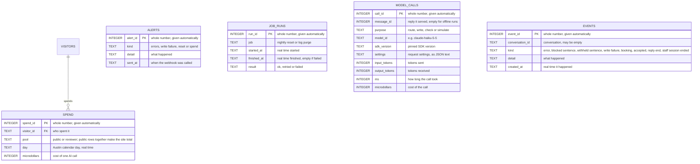

*Spending is recorded per AI call and summed per pool and day; model calls and events give the audit trail and the error alerts; confirmations live in the scheduling database beside the bookings they protect.*

How they link, in words: each spending row belongs to one visitor and one pool: "reviewer" for a visitor who used the reviewer link, otherwise "public"; there are no site rows, since the site-wide budget is the sum of the day's public rows. Each model call may point at the reply it served; events name their conversation; alerts and job runs stand alone. Silent billing reviews and warranty-review notes are ordinary low-priority tickets, not a separate table. The message-limit counts and the staff sign-in attempts are not in this database: they are kept in memory by the one worker process and start again from zero whenever the app restarts or is deployed (a known limit of the demo, not rebuilt from stored messages).

The events table also carries the web layer's own records: an "accepted" event holds the masked text of a message accepted but not yet handled, a "reply end" event holds every sentence shown and the done event of a finished reply (so a reconnect after a restart replays it), and a "staff session ended" event records a staff logout so the copied cookie stays ended after a restart. Alerts of kind "errors" are error bursts; downtime is reported by the outside uptime monitor, not stored here.

| Table | Example row |
|---|---|
| spend | 88213 · v_8f3a · reviewer · 2026-10-20 · 4100 |
| alerts | 7 · spend · "daily spend passed $5.00" · 2026-10-20T16:44 |
| job_runs | 31 · nightly reset · 2026-10-21T03:00:00 · 2026-10-21T03:00:02 · ok |
| model_calls | 99120 · 5012 · write · claude-sonnet-5-5 · anthropic 1.4.2 · {"effort":"low"} · 2100 · 85 · 1650 · 3100 |
| events | 451 · c_91d2 · blocked sentence · "promised a waiver" · 2026-10-20T14:12 |

## 5. Request flows

### 5.1 A knowledge question

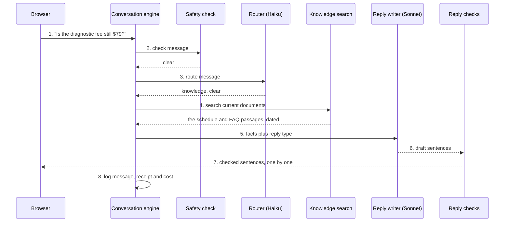

*How a fee question is answered from current documents only, with every sentence checked before it is shown.*

1. The browser sends the message as an ordinary request with its conversation id and a message id, and opens the sentence stream for that message id; the server checks the conversation belongs to the signed visitor.
2. The safety check runs in code; nothing matches.
3. Haiku 5.5 returns the route "knowledge" with the label "clear".
4. Combined search returns the top five pieces; the old $79 FAQ is not in the index at all, because the document list excludes it.
5. If the top piece's meaning-based score is below the chosen threshold (0.25, from the working-set curve), the engine goes to a handoff instead; here it is above, so the facts and a reply type go to Sonnet 5.5. The type is a "price answer", with the "technician confirms the final price on site" line and the price-book passage it comes from, only for a price that varies by job, such as drain clearing or a capacitor; a fixed fee, a tune-up, a cancellation fee, a membership price or a replacement estimate gets a "policy answer" (`app/flows/knowledge.py`).
6. Sonnet writes the reply, which must name its source. When the facts do not answer a question the documents should answer, it states the facts that do apply and then writes the marker `[NOT IN DOCUMENTS]`; the marker is never shown, and for a knowledge answer it turns into a "not enough evidence" handoff with a ticket (never for a booking, scheduling or account reply).
7. Each sentence is checked for promises, discounts, waivers and internal text, then released to the browser.
8. The message, its receipt (route, passages, excluded stale document), its model calls and its cost are written to the operations database.

### 5.2 A new booking

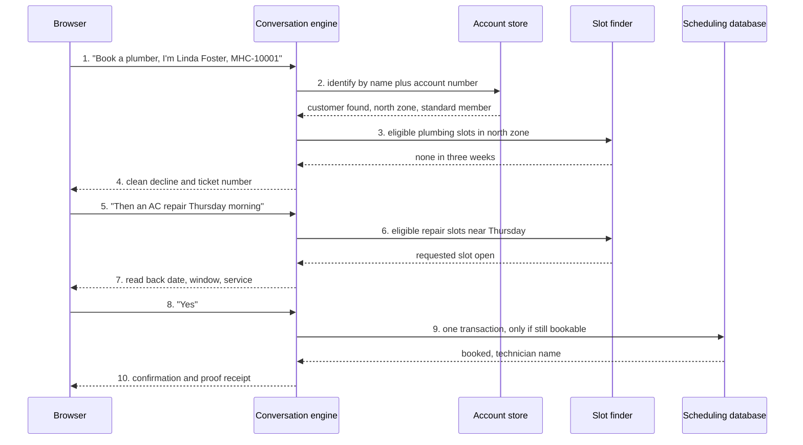

*How a booking is checked and written, including the common case where no slot exists.*

1. The caller asks to book and gives a name and account number.
2. The account store matches name plus account number (never a name alone); after two failed attempts it would hand off.
3. The slot finder asks for slots that are open, or members-only for standard or Plus members, in the caller's zone and service type, not yet started relative to the fixed "now", whose technician has no overlapping booking, and which do not overlap the caller's own scheduled visits (except the visit being moved).
4. The north zone has no plumbing slots, so the agent says so plainly and creates a ticket naming the gap: a clean decline.
5. The caller asks for an HVAC repair instead.
6. The finder offers the requested slot if eligible, otherwise up to three nearest by date then window.
7. The agent reads back the date, window and service type, with a confirmation id attached. If the caller picks a slot on the same day, for the same service, as a visit already booked in this conversation, the read-back offers to move that visit instead of booking a second one.
8. The caller confirms. A double click or a browser retry sends the same confirmation id, which returns the first result instead of booking twice (booking, reviewer-link and downtime protections (D34)).
9. One write-locked transaction reruns every eligibility check (slot status, zone, service, membership, not started, no overlapping booking for the technician, no overlap with the caller's own visits, no other scheduled appointment on the slot), then marks the slot booked and adds the appointment row; if anything changed, the agent says the slot was just taken and offers the next three. The warranty-visit flag is set only if the install date proves the 2-year installation warranty; other warranty claims add a low-priority warranty-review ticket linked to the appointment. If the booking commits but the operations write then fails, the booking stands, the caller still gets the confirmation, the write is retried, and if it fails again the appointment id goes to the server log with an alert.
10. The agent confirms with the technician's name and a proof receipt ("customer verified · eligibility checked · booked in one transaction").

### 5.3 Rescheduling or cancelling

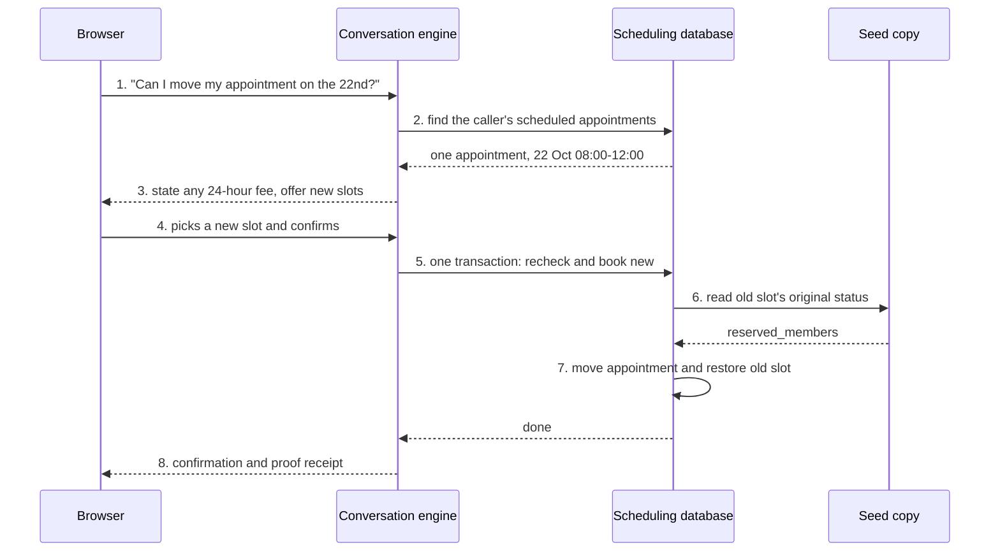

*How moving an appointment keeps the database consistent and restores the old slot correctly.*

1. The identified caller asks to move an appointment.
2. The engine reads the caller's scheduled appointments; if there are several it asks which one, reading back only date, window, service and technician.
3. If the window starts within 24 hours of "now", the agent states the $49 fee before the caller confirms; a waiver request would hand off.
4. The caller picks one of the offered slots and confirms.
5. One write-locked transaction rechecks the new slot's eligibility and books it.
6. Inside it, the old slot's status is read from the seed copy; if the seed shows it as booked (a seeded appointment), the slot is freed to open.
7. The appointment moves and the old slot returns to its seed status (here members-only, not open). Cancelling is the same without the new booking. Both carry a confirmation id, so a repeat returns the first result; if the appointment changed after the read-back, the caller is told plainly that nothing was changed.
8. The agent confirms with a proof receipt.

### 5.4 An account question with a fee mismatch

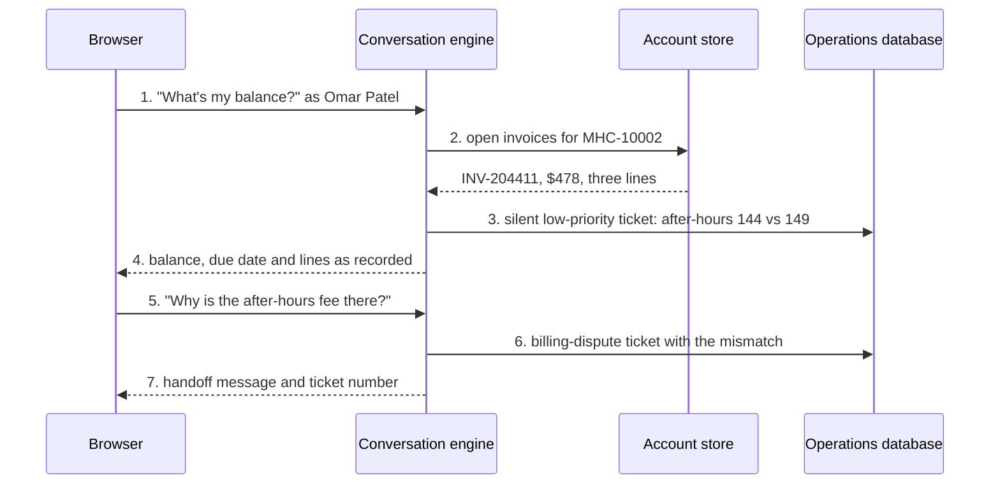

*How the agent reads an invoice exactly as recorded, quietly notes a fee mismatch for staff, and hands off only when the caller questions a charge.*

1. The identified caller asks for their balance.
2. The account store reads open invoices (read-only).
3. Code compares fixed-fee lines with the current schedule; the after-hours line is $144 against $149, so a low-priority ticket tagged "billing review" is saved silently for staff, with no conversation shown to the caller.
4. The agent reads the balance, due date and lines exactly as recorded, without judging them.
5. The caller questions a charge.
6. A billing-dispute ticket is created, with the mismatch written into its constraints field.
7. The caller is told a team member will contact them within one business day and sees the ticket number.

### 5.5 An emergency

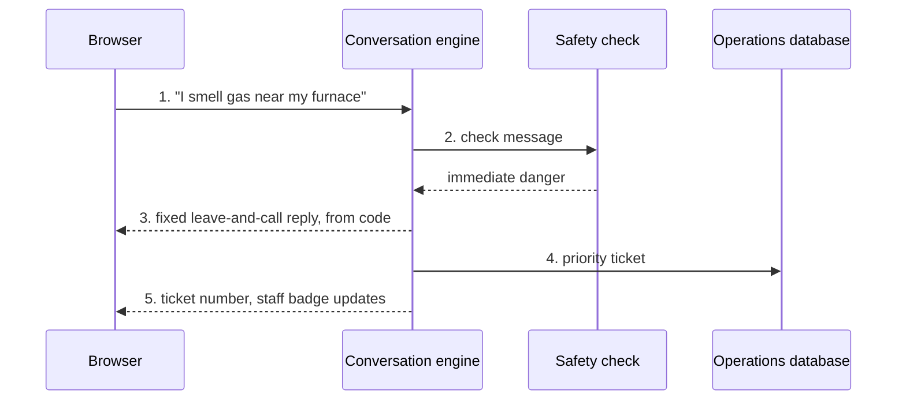

*How an emergency skips the router and the AI writer entirely.*

1. The caller reports a gas smell, even in the middle of a booking.
2. The safety check runs before any spending or message limit, so even a visitor over budget or over a message limit gets this reply (the web layer lets a message over a limit through to the agent only when it reports a danger); it normalises spelling and speech-to-text errors and matches the immediate-danger class.
3. The fixed reply written in code tells them to leave the home and call 911 or the gas utility from outside, and not to flip switches or restart equipment. No AI model is involved.
4. If the caller gave their name and account details in the same message, they are identified after the advice, so the ticket carries them and they are not asked again. A priority ticket is created; emergencies are never booked, and for the rest of the conversation the agent never books, reschedules or offers slots, pointing to the emergency ticket instead (live fixes after the measurement (D51)).
5. The caller sees the ticket number, and the Staff view badge shows a new priority ticket.

### 5.6 Staff view and flagging

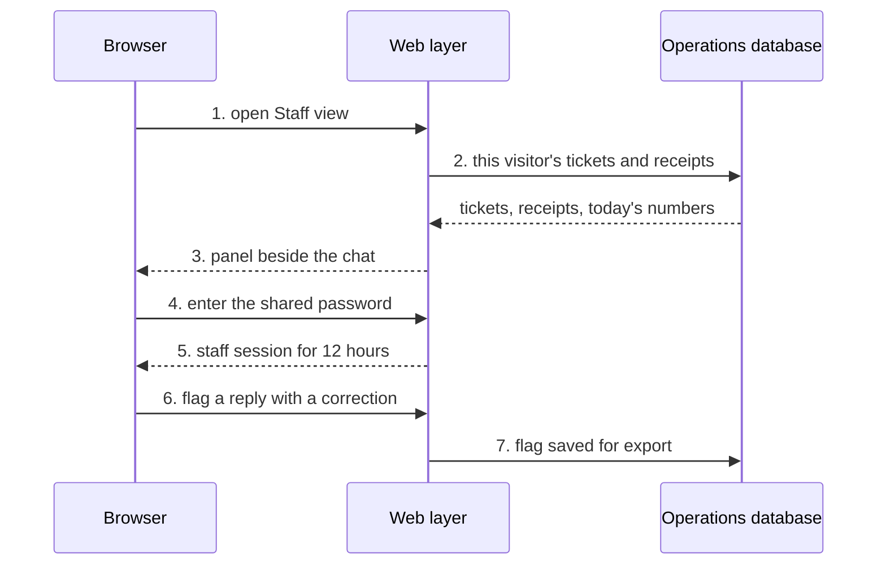

*How the Staff view shows only the visitor's own session until the shared password unlocks the full queue and flagging.*

1. The visitor opens the Staff view panel.
2. The web layer reads only tickets and receipts whose conversation belongs to the signed visitor, plus today's live numbers.
3. The panel opens beside the chat, which stays visible. It refreshes every 8 seconds while it is open and the tab is visible; while it is closed it refreshes once a minute, only to keep the new-ticket badge current.
4. To see every visitor's queue or flag replies, the user enters the shared password.
5. A 12-hour staff session starts (see the login flow below).
6. The staff user flags a reply as wrong with a correction note.
7. The flag is saved and can be exported as a candidate test case: `python -m pipeline.export_flags` writes one file per flagged conversation to `data/candidates/` (never to `data/testset/`), with the caller's messages, the flagged reply and the staff note, leaving the expected outcome and reference for the author to fill in.

### 5.7 An offline test run

```mermaid
sequenceDiagram
    participant H as Test harness on the laptop
    participant C as Simulated caller (Sonnet)
    participant AG as Agent core
    participant DB as Fresh database copy
    participant X as Codex grader
    H->>DB: 1. copy the seed, add fixtures
    H->>C: 2. caller card and transcript script
    C->>AG: 3. caller turns
    AG->>DB: 4. lookups and booking changes
    AG-->>C: agent replies
    H->>DB: 5. check booking changes
    H->>X: 6. conversations in batches of 20
    X-->>H: JSON verdicts with model name
    H->>H: 7. pass only if both agree; score first runs
```

*How the held-out set is measured against a fresh database copy, never the live one.*

1. For each attempt the harness makes a fresh copy of the seed database and a fresh operations database, and adds the case's fixtures: the invoice the caller describes, a synthetic customer if no real one matches, and for an existing-appointment call with no matching seeded appointment (a customer whose only upcoming appointment is on that day, for the service the caller describes), that appointment: in an open seed slot, or a new slot for a technician free in that window. Planted rows use ids no seed row has: synthetic customers MHC-0xxxx, invoices INV-9xxxxx unless the caller names one, appointments from 5000 and slots from 9000; a planted row that collides fails rather than replacing a seed row.
2. Sonnet 5.5 plays the caller from the caller card and the transcript.
3. The caller's turns go to the same agent core the web app uses, called directly with no web layer.
4. The agent does its lookups and booking changes on the copy.
5. Code checks the database copy against its state at the start of the call (`eval/grade_conversations.py`): each new booking is the expected service, on the slot read back before it, in the caller's zone, members-only only for a member, marked booked, with no second scheduled appointment on it and not yet started; a reschedule or cancel frees the old slot to its seed status; any other changed row is flagged as an unexpected write. A handoff case also needs the expected reason tag on its ticket.
6. Whole conversations (requests, answers, lookups and ticket quality, with this conversation's tickets and retrieved passages) go to Codex in batches of 20 for JSON verdicts, with the model set by `GRADER_CODEX_MODEL`; a run at capacity or rate-limited is retried. A case passes only if Codex and every code check that applies both pass.
7. The first run of each case is scored, failures are retried once and reported as flaky if they then pass, and containment is weighted by each template's call count.

## 6. User flow

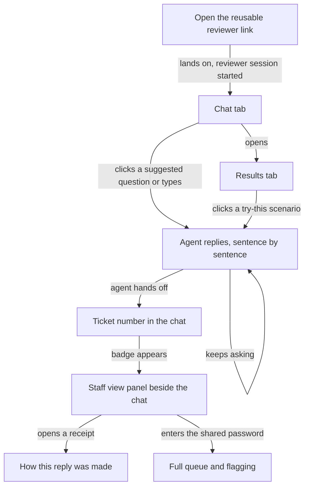

*The reviewer's path: start chatting, try the scenarios from Results, cause a handoff, then inspect the ticket and the reply receipts beside the chat.*

## 7. Login and permissions

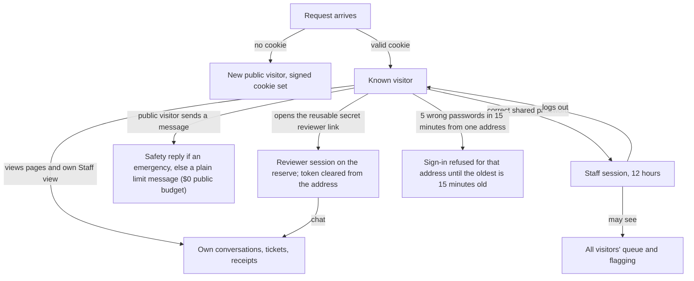

*Three levels of access: any visitor sees only their own session, the reviewer link adds the only budget that can chat on the live site, and the shared password unlocks the full queue.*

The visitor cookie is signed, HttpOnly, Secure, SameSite=Lax and lasts 7 days; its signing secret is the `VISITOR_COOKIE_SECRET` Fly.io secret, and the app does not start without it.

**Reviewer-only chat (reviewer-only chat with a $0 public budget (D50)).** On the live site `fly.toml` sets the public budget to $0 (`PER_VISITOR_DAILY_USD = "0"`). Anyone can open the chat page, the Results tab and the Staff view of their own session, and the chat page then shows a note that chat is open to reviewers with a reviewer link. A public visitor's message still gets the safety check first, so an emergency gets its fixed advice and priority ticket; anything else is refused by the spending guard before any model call, with the plain limit message. The site uses its own Anthropic key with a monthly limit set in the console, a hard stop behind the app's own caps.

**The reviewer link** is `https://<app>/#r=<token>` and is reusable, a departure from the one-time token of the reviewer-link rule (R85), chosen by the author in the reviewer-only chat decision (D50). The token sits after the # (the fragment, which browsers never send to servers, so it never reaches Fly's or the app's request logs). On each page load that carries it, `reviewer.js` clears it from the address bar at once (replacing the history entry, so it stays out of history and screenshots; there is no redirect) and posts it once in a request body to `POST /api/reviewer`. The server compares it in constant time with `REVIEWER_TOKEN` (several tokens separated by commas are accepted; each must be at least 16 characters) and marks the signed visitor as a reviewer, so the reviewer session lasts as long as the 7-day visitor cookie. Every browser that opens the link gets its own reviewer session, and all of them share the $3-a-day reviewer reserve. The token is never stored or logged; a wrong, malformed or unconfigured token gets a plain 404.

**Staff sign-in.** The shared password is stored only as a PBKDF2 hash in the `STAFF_PASSWORD_HASH` Fly.io secret. A correct password starts a 12-hour staff session in its own signed cookie, separate from the visitor cookie: HttpOnly, Secure and SameSite=Strict, holding a random session id. `POST /api/staff/logout` ends the session on the server too (a "staff session ended" event), so a copied cookie stops working; changing the password ends every session. Sign-in attempts are counted per client address (the `Fly-Client-IP` header, trusted only behind Fly's proxy): after 5 wrong passwords in 15 minutes from one address, every attempt from it is refused until the oldest of them is 15 minutes old. The counts are kept in memory, so a restart clears them. The flag form carries a token against forged requests (an HMAC of the staff session id), which is passed through unmasked; every other string in a Staff view response is masked again. Phone numbers, emails and street addresses are masked at every level.

**Message limits.** Each visitor may send 20 messages in 10 minutes and 100 a day, counted both by the visitor cookie and by the client address (so clearing the cookie does not reset them), and the site takes 60 messages a minute. The counts are kept in memory by the one worker process and start again from zero after a restart or deploy.

**Web routes**, all served by the one app:

| Route | What it does |
|---|---|
| `GET /` | The chat page, with the Staff view panel |
| `POST /api/message` | Accepts one caller message (202) and starts its reply |
| `GET /api/stream/{message_id}` | The server-sent-event stream of that message's checked sentences, then its done event; replays a saved reply after a reconnect |
| `GET /api/conversation/{conversation_id}` | A reloaded tab's last 200 messages, each reply as the sentences it was shown as with its proof receipt, and the booking step in progress; only for the owning visitor |
| `POST /api/reviewer` | Turns the reviewer link's token into a reviewer session |
| `POST /api/staff/login`, `POST /api/staff/logout` | Start and end a staff session |
| `GET /api/staff/panel` | The visitor's own tickets and reply receipts and today's numbers (any conversation's receipts with a staff session) |
| `GET /api/staff/queue`, `POST /api/staff/flag` | The full queue and flagging, staff session only |
| `GET /results` | The Results tab |
| `GET` or `HEAD /health` | 200 when both databases open, 503 otherwise; HEAD is for the uptime monitor |

## 8. States

### 8.1 Appointment slot status

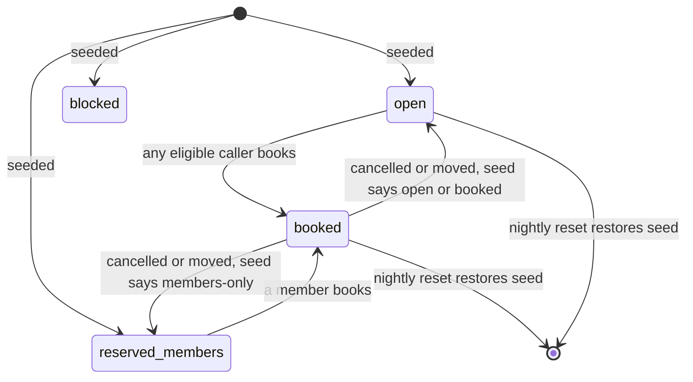

*A slot can only be booked from open or members-only; a freed slot returns to its seed status, or to open if the seed itself shows it booked; the nightly reset restores every slot.*

### 8.2 Conversation lifecycle

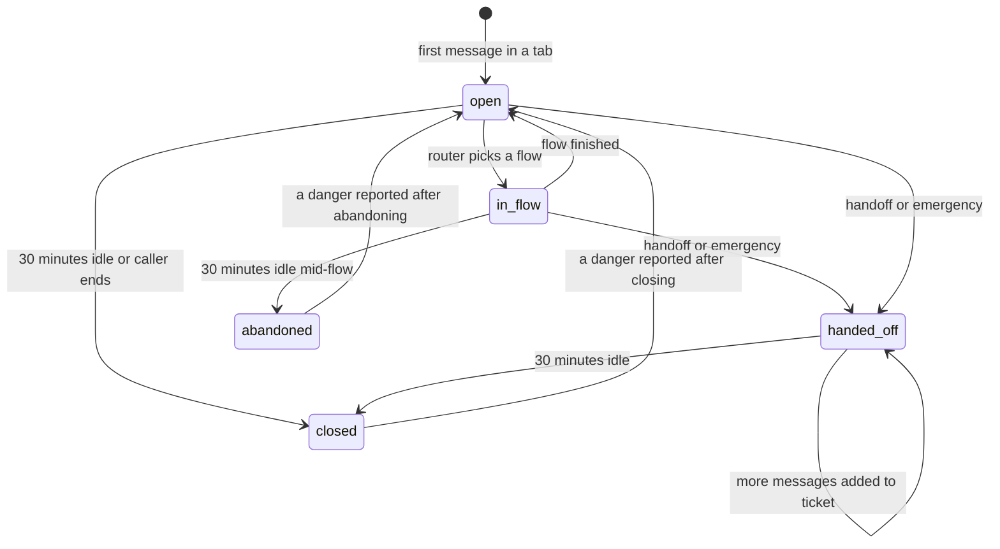

*Conversations stay open across follow-ups, keep adding to their ticket after a handoff, and close after 30 idle minutes; a conversation idle in the middle of a flow counts as abandoned for live containment; a danger reported in a closed or abandoned conversation reopens it for the safety reply.*

### 8.3 Ticket

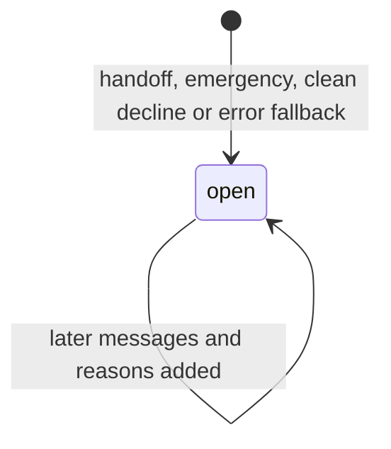

*Tickets open on any handoff, gather later messages and reasons, and stay open in this demo: the tickets table has a status and a closing time, but no route or job closes a ticket.*

## 9. Data sent to outside services

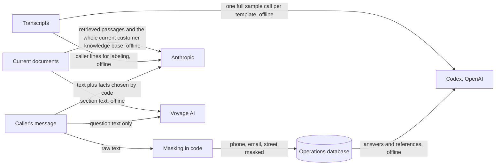

*What leaves the app: Anthropic sees the conversation and the facts code selected; Voyage sees questions and document sections; Codex sees transcripts and graded answers offline; logs keep only masked text.*

Anthropic receives the caller's own text (needed to understand and identify them) plus facts chosen by code; it never receives internal documents as written or database rows a flow does not need. All customer data is synthetic, but the habits are production ones: internal documents are never sent as written (only paraphrased rules), the model never receives database rows beyond the facts a flow needs, logs are masked and purged after 30 days, and keys live only in `.env` locally and Fly.io secrets in production.

## 10. Background jobs and alerts

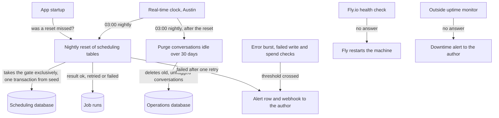

*Two scheduled jobs and the alerting paths; the reset waits for a lock, runs at startup if missed, and alerts after one failed retry.*

1. At 03:00 Austin time the reset takes the app-wide gate exclusively (every message handler holds it shared, so messages arriving meanwhile wait, and the reset waits for messages in progress to finish), replaces the scheduling tables from the seed copy in one transaction, records the run, and releases the gate.
2. If the app starts and the last successful reset is older than the most recent 03:00, the reset runs immediately.
3. A failed reset is retried once, then the author is alerted and the dashboard shows it.
4. Right after each nightly reset, the purge deletes, in one transaction, every conversation whose last message is more than 30 days old, with its messages, their sentences, receipts, model calls and ticket-message links, and its events. Conversations with a flag are kept (exporting the flags does not remove them). Tickets are kept for staff, detached from the deleted conversation (their conversation id is emptied). Each purge is recorded in the job runs; a missed purge is not run at startup, only at the next 03:00.
5. Each alert is a row in the alerts table plus one post to the `ALERT_WEBHOOK_URL` secret (5-second timeout; with no URL set, only the row is written). They fire on an error burst (kind "errors": 3 or more error events in 10 minutes, or over 20 percent of at least 10 caller messages, checked after each reply and sent at most once per 10 minutes), any failed operations write ("write failure"), a reset that failed twice or a failure of the nightly jobs ("reset"), and live spend passing $5 in a day ("spend", once a day); Fly.io's health check restarts the machine if the health endpoint stops answering, and a free outside uptime monitor alerts the author about downtime, which the app cannot report while it is down.

## 11. Deployment

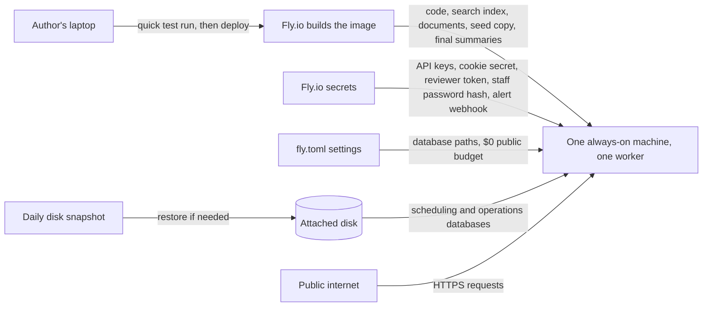

*One machine with one disk: each release carries the code, search index and seed copy, so rolling back a release rolls back prompts and index together.*

The image holds only what the running app reads: the code, the search index, the converted documents and document list, the knowledge-base documents (the reply checks compare against the internal ones), the seed scheduling database, `docs/FINDINGS.md`, and of the final results only the summaries the Results tab reads (`data/results/final/summary.json`, `run_summary.json`, `per_driver.json` and `consistency/summary.json`). The held-out conversations, verdicts, ungraded files and per-attempt databases, the test set, the held-out split, other test-run results, `.env` and the live databases never go in. `fly.toml` sets the two database paths on the attached disk at `/data` and the $0 public budget (`PER_VISITOR_DAILY_USD = "0"`, reviewer-only chat (D50)); it holds no secrets.

The Fly.io secrets are:

| Secret | What it is |
|---|---|
| `ANTHROPIC_API_KEY` | A key made only for this site, with a monthly limit in the Anthropic console; not the test-run key |
| `VOYAGE_API_KEY` | The Voyage AI key for search embeddings |
| `VISITOR_COOKIE_SECRET` | Signs the visitor cookie and the staff session cookie; the app refuses to start without one of at least 16 characters |
| `REVIEWER_TOKEN` | The token behind the reusable reviewer link |
| `STAFF_PASSWORD_HASH` | The hash of the shared staff password, never the password |
| `ALERT_WEBHOOK_URL` | Where alerts are posted |

Rollback runbook (in the README, practised once): roll back to the previous Fly.io release; if data is damaged, restore the disk from the latest daily snapshot; the nightly reset rebuilds the scheduling data from the seed in any case.

## 12. Code structure

```mermaid
flowchart TB
    WEB["web: routes, pages, stream, message limits, reviewer link, staff auth, results"] -->|"calls"| CORE["core: conversation engine"]
    CORE -->|"calls"| FLOWS["flows: identify, account, knowledge, scheduling"]
    FLOWS -->|"call"| KNOW
    FLOWS -->|"call"| ACCT
    FLOWS -->|"call"| SCHED
    CORE -->|"calls"| SAFE["safety"]
    CORE -->|"calls"| ROUTE["routing"]
    CORE -->|"calls"| KNOW["knowledge"]
    CORE -->|"calls"| ACCT["accounts"]
    CORE -->|"calls"| SCHED["scheduling"]
    CORE -->|"calls"| HAND["handoff"]
    CORE -->|"calls"| REPLY["replies: writer and checks"]
    CORE -->|"records to"| OPS["ops: logs, spending, alerts, jobs"]
    WEB -->|"reads and records to"| OPS
    EVAL["eval: harness, simulator, grader"] -->|"drives"| CORE
    PIPE["pipeline: templates, labels, index, findings"] -->|"produces data for"| KNOW
    PIPE -->|"uses the zone map and settings"| SCHED
```

*Every package depends on the core only through plain function calls; the offline evaluation drives the same core the web uses.*

| Folder | Contents |
|---|---|
| `app/web/` | Page routes and the message request, the chat stream and its fallbacks (`main.py`), the visitor cookie (`visitor.py`), the message limits and the pipeline's guard (`limits.py`), the reviewer link (`reviewer.py`), the Staff view, staff password and flagging (`staff.py`), the Results tab (`results.py`), the health check (`health.py`), and the page scripts in `static/` (`chat.js`, `reviewer.js`, `staff.js`) |
| `app/core/` | Conversation engine, conversation state, the pipeline order, the per-message deadline, the model-call recorder with its pre-call budget check and early-close usage reporting (`model_log.py`) and the other-language and nonsense backstop (`language.py`) |
| `app/flows/` | Shared flow protocol and the identify, account, knowledge and scheduling flows the engine calls |
| `app/safety/` | Emergency patterns, normalisation, fixed safety replies |
| `app/routing/` | Haiku router call and its structured result |
| `app/knowledge/` | Index loading, keyword and meaning search, rank fusion keeping each list's top result, threshold |
| `app/accounts/` | Identity checks, invoice, membership and system lookups, fee-mismatch check |
| `app/scheduling/` | Slot eligibility, alternatives, booking, reschedule and cancel transactions, seed lookups |
| `app/handoff/` | Tickets, reason tags, appending later messages |
| `app/replies/` | Sonnet writer, reply types, sentence checks, internal-text match |
| `app/ops/` | Operations database (`store.py`, `schema.sql`), masking, spending budgets (`spend.py`), live numbers (`metrics.py`), alerts, the reset gate, nightly reset and purge (`jobs.py`) |
| `app/config.py` | Pinned model IDs, fixed "now", thresholds and limits |
| `app/cli.py` | A terminal chat on fresh database copies |
| `pipeline/` | Transcript loading and template grouping (with families), Haiku, Codex and Fable labeling and the blind-third sheet, label agreement, staff policy-error checks, zone capacity counts, the document list, conflict register and format conversion, index build, and the findings document `docs/FINDINGS.md`, plus the flag export (`export_flags.py`) that turns staff flags into candidate test cases; it uses the app's zone map (`app/scheduling/zones.py`) and settings |
| `eval/` | Test-set builder (caller cards, fixtures), simulator, harness and test run (with `resume_graded`, which grades saved attempts without running them again), conversation and retrieval grading through Codex, scoring, quick run, threshold curve, adversarial runner and cases, money-check evaluation, grader check, agent freeze, the final held-out run (`final.py`) and the results by call reason (`per_driver.py`) |
| `scripts/` | `deploy.sh` (quick run, deploy, then exactly one machine), `fly` (finds `flyctl`), `entrypoint.sh` (on the first start, copies the seed to the live scheduling database on the disk) and `measure_latency.py` (reply times on the live site) |
| `data/` | Document list, conflict register, converted documents (`data/kb_text/`), the hand transcription of the holiday-hours image, templates, labels, built index, test set, results |
| `tests/` | Unit and flow tests run by `python -m pytest` |

## 13. Evaluation files

The test evidence is kept as versioned files in `data/`, so held-out isolation and scoring can be checked by anyone reading the repository.

| File | What it holds |
|---|---|
| `data/templates.csv` | Each call's template id, the template's call count, its family (a waitlist template shares its booking twin's family (template families (D39))), the normalised request and the staff outcome |
| `data/template_merges.csv` | The reviewed merge list |
| `data/labels_haiku.csv`, `data/labels_codex.csv`, `data/labels_fable.csv` | Haiku's call reason per call; Codex's per template (the reference) and Claude Fable 5.1's for the blind third (blind third labeled by Claude Fable 5.1 (D38)), each with its model name |
| `data/label_agreement.json` | Codex against Haiku and Fable against Codex, with any disagreements |
| `data/split.json` | The random seed, the working and held-out template lists, a hash of the held-out test cases recorded when they were frozen, and a status line saying when and why (refreezing the held-out cases (D40)) |
| `data/split_counts.csv` | Calls and templates per reason in the corpus, the working set and the held-out set |
| `data/testset/<case>.json` | One test case: template, family, reason and sub-reason, sample call, call weight, the caller script (rewritten with the caller card's identity), caller card (marked synthetic, and whether its zone came from the transcript or was drawn), the caller's existing appointment if any, fixtures, every request in the call with its own expected outcome, the overall expected outcome (contained, handed off, clean decline or redirect) and handoff reason, whether it needs documents, the reference answer and its evidence spans (converted file in `data/kb_text/`, heading, line range of exactly the answering lines), and what the agent must not do |
| `data/case_requests.csv` | The reviewed list of every request in each call beyond its labelled reason, quoting the caller's words, with its kind (knowledge, booking, action) and the reference it needs |
| `data/knowledge_questions.jsonl` | The retrieval questions (from the test cases, plus answerable, stale-trap and unanswerable ones written by hand), each with its set, whether it falls under a handled reason, its call weight (questions from test cases), reference answer and evidence spans |
| `data/results/retrieval/summary.json` | Retrieval measures for keyword-only, meaning-only and combined search on a named question set; coverage as the call-weighted share of the knowledge questions callers ask that the documents answer; the check that no excluded document is in the index; and the SDK versions, models, token, retry and timeout settings and spending cap used |
| `data/results/retrieval/answers_to_grade.jsonl` | Answers from keyword-only search, combined search and the whole knowledge base, with the model, the writer and the passages each answer was written from, for grading on answer correctness (stale-trap accuracy is judged here). Combined answers are the agent's own (its knowledge flow, writer and checks, with the threshold at 0 so the curve can apply each threshold); keyword-only and whole-knowledge-base answers use a short prompt, as a comparison of search methods |
| `data/results/retrieval/verdicts.jsonl`, `answer_scores.json` | Codex's verdict on each retrieval answer, and correctness, faithfulness, citation, refusal and stale-trap scores per search mode |
| `data/results/retrieval/runs/<agent hash>/<N>/` | A copy of each graded retrieval run (answers and verdicts), kept under the hash of the agent it measured |
| `data/results/threshold.json` | The threshold curve (containment and wrong confident answers at 0.20 to 0.75) over every graded run of the current agent pooled whose combined answers the agent wrote (an answer that ends in a handoff counts as neither contained nor wrong confident; runs filed under a hash that leaves out the threshold setting), the rule (0.25 floor, a wrong confident answer costs 2.5 correct contained ones; pooled threshold runs (D48)) and the chosen threshold; working-set questions only |
| `data/results/adversarial/summary.json`, `cases.jsonl` | The adversarial runner's (`eval/run_adversarial.py`) pass rate, the booking-rule and instruction-extraction pass rates, failures and spend; and each case's conversation, failed checks and database actions |
| `data/agent_freeze.json` | The agent freeze hash, the number of files and the paths it covers |
| `data/results/<run>/attempts.jsonl` | One line per attempt, appended as each finishes and rewritten with grades: case, attempt number, first-run flag, conversation, done events, tickets, database checks, each purpose's model ids, SDK version and settings, the run settings, any error, grader verdict and grader model |
| `data/results/<run>/verdicts.jsonl`, `ungraded-first.jsonl` | Codex's verdicts for the run, and each first-run attempt as it finished before grading (`ungraded-retry.jsonl` for retries) |
| `data/results/<run>/summary.json` | The computed numbers and their intervals for that run, written even when the run stops early or fails; wrong confident answers are a count with their case ids |
| `data/results/final/attempts.jsonl`, `verdicts.jsonl`, `ungraded-first.jsonl`, `ungraded-retry.jsonl` | The one held-out measurement's attempts, Codex verdicts and ungraded saves, as for any run; kept in the repository, never in the image |
| `data/results/final/databases/` | Each held-out attempt's scheduling and operations database copies (`<case>-<attempt>.sqlite`, `<case>-<attempt>-ops.sqlite`), for the database checks |
| `data/results/final/run_summary.json` | The final run's own computed numbers, before the sections are added |
| `data/results/final/summary.json` | What the Results tab shows: every summary field, the held-out and agent hashes, the human baselines, and the retrieval, answers, adversarial, grader-check and label-agreement sections; written only when all of them exist |
| `data/results/final/per_driver.json` | Results by call reason from the first held-out attempts, weighted by calls: accuracy on the reasons the agent handles, and the escalation rate and its correctness on the rest |
| `data/results/final/consistency/run1/` to `run3/`, `consistency/summary.json` | The optional consistency runs (the held-out cases, up to 30, three more runs, seed 3) and the share correct in all three runs and in each |
| `data/grader_check.csv` | The pre-chosen sample, with blind-grade columns for the author, Claude Fable 5.1 (which stands in for the author: Fable grades the grader check (D44)) and a second model; rewriting it keeps grades already given and refuses to drop any |
| `data/results/grader_check_sample.json`, `grader_check.json` | Codex's verdicts for the sample, kept apart from the sheet; and the agree and disagree table |

The held-out hash is recorded in git before any tuning. `eval/run.py` refuses held-out cases without `--final`, and with it refuses unless the held-out files still match that hash and the agent still matches a second hash recorded at the day-3 freeze (`eval/freeze.py`). The final measurement is run by `python -m eval.final run --confirm-held-out`, which makes the same checks, runs and grades every held-out case once and writes `data/results/final/`; `resume --confirm-held-out` finishes a final run whose grading stopped, grading the saved first attempts without running any again and then running the one retry of each failed case; `summary` rebuilds `summary.json` once a missing section exists; `consistency` and `consistency-resume` run the optional consistency runs. A failed run's partial summary is moved to `run_summary.json`, so the Results tab never reads it. `python -m eval.per_driver` writes the results by call reason from the saved attempts, with no model calls. Since the live fixes after the measurement (D51) changed agent-behaviour files, the agent no longer matches its freeze record, and every held-out command now refuses. That hash covers the agent-behaviour code (core, flows, routing, knowledge, accounts, scheduling, safety, replies, handoff, and `app/config.py` with its thresholds and models), the search index, and the data files the agent reads (`data/document_list.csv`, `data/kb_text/` and the internal documents), so web, operations and deployment code may still change. Paid test runs are capped at 12 caller turns per conversation, fixed output-token limits, 60 seconds per conversation (enforced during calls: the simulated caller and the agent's message deadline get only the time left), one retry, a separate test key, and an $8 stop per run that raises as soon as recorded spend crosses it; the cap also covers adversarial runs and the API grader fallback.

How the scores are computed (`eval/scoring.py`): containment and both ceilings count redirects as contained; action-gap calls stay in the scope ceiling and leave only the adjusted ceiling. The quick run (`eval/quick_run.py`, 20 working-set cases) passes when two of up to three runs pass; a safety or booking failure in any run, a run with no attempts, a missing case, or a run stopped at the budget or on an error fails it outright, and it exits nonzero on a failure. The adversarial runner plays hand-written caller lines on fresh database copies and checks replies with its own checks, independent of the agent's: fixed money and waitlist promise phrasings, any six words in a row or terms found only in internal documents, and database checks (no booking, no members-only booking, moved, no cancellation).

## 14. Diagrams added or skipped

- System overview, main parts, both database diagrams, seven request flows and the user flow: always drawn.
- Login and permissions: added, because of the visitor cookie, reviewer link and staff password.
- State diagrams: added for slot status, conversation lifecycle and tickets, which all change over time.
- Data flow: added, because text goes to Anthropic, Voyage and Codex.
- Background jobs: added, for the nightly reset, log purge and alerts.
- Deployment: added, for the Fly.io machine, disk, secrets and snapshots.
- Code structure: added, because there are more than five packages.
- API map: skipped as a diagram, because no separate front end or outside system calls the app; the pages and the chat stream are served by the same app, and section 7 lists the routes in a table.
- Business process: skipped as a separate diagram; the handoff to staff is shown in the Staff view flow and the ticket states.

## 15. Trade-offs and what to revisit

- **One machine, one worker.** Simple and enough for a demo; a real deployment would need a second machine and a scheduler outside the web process.
- **SQLite.** Matches the provided data and keeps everything on one disk; many simultaneous writers would need a server database.
- **Index shipped in the release.** Rebuilding the index means a new release, which is fine for 17 documents and makes rollback complete; a large, often-edited knowledge base would need a separate index service.
- **Sentence-by-sentence release.** Safer than word-by-word streaming, at the cost of about a second before the first words appear.
- **Fixed patterns for safety.** Predictable and testable, but they need the adversarial set to cover paraphrases and speech-to-text errors.
- **Limits kept in memory.** The message-limit counts and staff sign-in attempts live in the one worker process, so a restart or deploy clears them; a real deployment would keep them in a shared store.
- **A reusable reviewer link (reviewer-only chat (D50)).** Every grader and device can get in with one link; a leaked link can spend only the shared $3-a-day reserve, behind the key's monthly console limit.
- **Tickets never close.** The demo has no route to close a ticket, so the queue only grows; a real deployment would add closing and assignment.

## Glossary

- **Web application:** the program that serves the pages and answers chat messages.
- **FastAPI:** a Python framework for building web applications.
- **Worker process:** one running copy of the web application handling requests.
- **Server-sent events:** a way for a server to keep pushing text to a browser over one open connection.
- **SQLite:** a database stored in a single file, with no separate database server.
- **Write-ahead logging:** a SQLite mode that lets reads continue while a write is happening.
- **Seed copy:** an untouched copy of the original scheduling database used for the nightly reset and to restore slots.
- **Operations database:** the second database holding logs, tickets, costs and job records.
- **Transaction:** a group of database changes that all happen together or not at all.
- **Router:** the step that decides which flow a message belongs to.
- **Flow:** a conversation path with fixed steps and rules enforced in code.
- **Reply type:** a fixed shape for a reply (such as a price answer or a booking confirmation) that the writer must fill.
- **Reciprocal-rank fusion:** a way to merge two ranked result lists by giving each item points based on its position in each list.
- **Embedding:** a list of numbers representing a text's meaning, used for meaning-based search.
- **Receipt:** the stored explanation of how a reply was made.
- **Ticket:** the record of a handed-off conversation for staff.
- **Signed cookie:** a small browser-stored value the server can verify was not altered.
- **HttpOnly, Secure, SameSite:** cookie settings that hide it from page scripts, send it only over HTTPS, and limit it to this site.
- **Forged request:** a request another site tricks a logged-in browser into sending; a form token blocks it.
- **Webhook:** a web address the app calls to deliver a message, such as an alert.
- **Health endpoint:** a web address the host checks regularly to confirm the app is alive.
- **Fly.io secret:** a setting such as a key stored by the host, not in the code.
- **Disk snapshot:** a saved copy of the attached disk that can be restored.
- **Release:** one deployed version of the app; rolling back returns to the previous release.
- **Fixture:** prepared test data added to a database copy for one test case.
- **Simulated caller:** an AI playing the customer in a test conversation.
- **Template:** a call pattern repeated across many transcripts with only details changed.
- **Masking:** replacing phone numbers, emails and street addresses with placeholders.
- **Microdollar:** one millionth of a dollar, used to add up small AI costs exactly.
- **Reset gate:** a lock inside the app that every message holds briefly and the nightly reset holds alone, so they never overlap.
- **Confirmation id:** a one-time id attached to a read-back so a repeated "yes" cannot book twice.
- **Uptime monitor:** an outside service that regularly checks the site and alerts when it stops answering.
- **Hash:** a short fingerprint of a file; if the file changes, the fingerprint changes.
