# Architecture: AI Call Center Agent for Meridian Home Comfort

## Summary

**The problem.** Meridian Home Comfort, a fictional heating, cooling and plumbing company in the Austin area, cannot keep up with its calls. The challenge (`docs/PRD.md`) is to build, in four working days, a chat agent at a public web address that answers routine calls from the company's documents, reads callers' accounts, books and changes appointments in a provided SQLite database, hands everything else to a human with full context, and proves its performance with numbers measured on held-out data.

**The approach.** One Python web application on one always-on Fly.io machine. Every caller message passes through a fixed pipeline: a safety check written in code, a fast AI router (Claude Haiku 5.5) that picks a flow, and a flow whose rules are enforced in code (knowledge answers from document search, read-only account lookups, booking changes in database transactions, and handoff tickets). Claude Sonnet 5.5 only writes the wording of replies, and every sentence is checked in code before it reaches the screen. A separate operations database records every conversation, ticket, cost and error, feeds the staff view and alerts, and is never touched by the nightly reset of the scheduling data. Offline tools, run on the author's laptop, sort the transcripts, build the search index, run the simulated-caller test set and grade answers through Codex.

**Where the project stands.** The intent (`docs/DESIGN.md`), the specification (`docs/SPEC.md`, 86 numbered requirements), this architecture and the plan (`docs/PLAN.md`) are approved, with the decisions recorded in `docs/DECISIONS.md`; the technology stack is its own decision (technology stack (D35)). Milestones 1 and 2 of 6 are built: configuration and the agent-core interface, transcript templates and labels, the findings document (`docs/FINDINGS.md`) and the prepared documents; then section-based keyword and meaning search, the frozen working and held-out test cases, and the standalone retrieval results. The later milestones are planned.

## 1. System overview

The system has three kinds of user (the reviewer or a caller, the author, and staff using the shared password), one web application, two databases on one disk, three outside AI services, and an offline toolkit on the author's laptop.

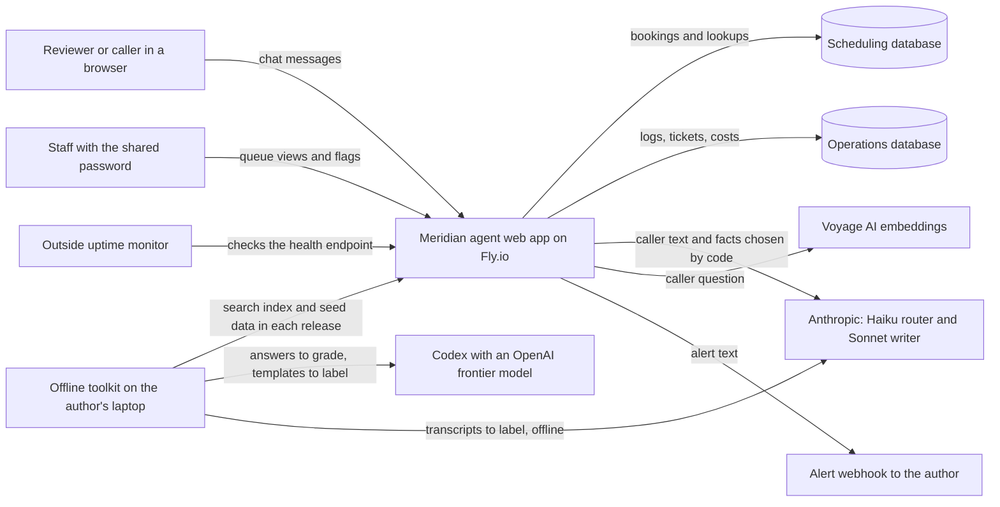

*The browser talks only to the web app; the app owns both databases and calls the AI services; the laptop toolkit prepares data and grades results offline; an outside monitor alerts the author if the app stops answering.*

## 2. Main parts

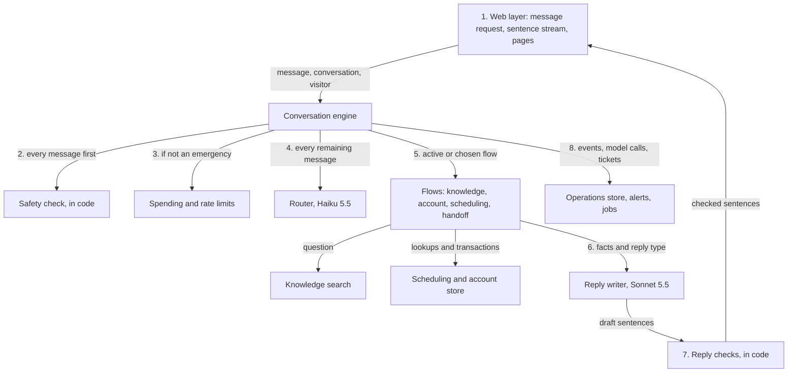

*Each message passes the numbered steps in order; the two AI models only choose a route and write wording, and code decides everything else.*

1. The browser sends each message as an ordinary request; the web layer checks that the conversation belongs to the signed visitor and opens a stream for that message's sentences.
2. The safety check runs first on every message, even mid-flow and even for a visitor over budget; an emergency gets its fixed reply, which costs nothing.
3. Only then are the spending and rate limits applied.
4. The router runs on every remaining message. With no flow active, its route picks the flow; with a flow active, its result is used only to detect a clear change of topic.
5. The active or chosen flow runs its code-owned steps.
6. The flow hands the writer the facts and a reply type.
7. Each sentence is checked before release. If a sentence fails, generation stops, the sentences already shown stay, the rest becomes a handoff message with a ticket, and a "blocked" event is logged.
8. Every step records events and model calls in the operations store.

The engine guarantees exactly one done event, always last: if the pipeline stops without one it adds an "incomplete" done event, and if the pipeline raises it adds an "error" done event; the handoff flow turns both into a handoff message.

| Part | What it does | Where its rules come from |
|---|---|---|
| Web layer | Serves the Chat tab, Results tab and Staff view; takes each message as a request and streams its checked sentences back; holds the visitor cookie; checks conversation ownership on every request | Web pages (R64 to R72) |
| Conversation engine | Keeps conversation state, runs the pipeline, keeps a flow active across follow-up messages | Conversation state (R40), conversation lifetime (R82) |
| Safety check | Matches emergency patterns in code before anything else and returns fixed replies | Safety classes (R34 to R37) |
| Router | Haiku 5.5 returns a route and "clear" or "unclear" | Router (R38, R39), routing model (D25) |
| Knowledge search | Combined keyword and meaning-based search over current documents: the top result of each list is always kept (keyword search's only when some word matches), then the top 10 of each list are merged by reciprocal-rank fusion; five results returned (combined search keeps each list's top result (D41)) | Document search (R24 to R32) |
| Scheduling and account store | Read-only lookups and booking transactions on the scheduling database | Booking rules (R45 to R56), data rules (D29) |
| Reply writer | Sonnet 5.5 turns facts chosen by code into wording, as structured reply types | Pricing and internal-text rules (R42, R43) |
| Reply checks | Checks every sentence for promises, refunds, waivers and internal text before release | Sentence release (R60) |
| Spending and rate limits | Per-visitor, site-wide and reviewer-reserve budgets; message limits | Guards (R61, R62), spending budgets with a reviewer reserve (D30) |
| Operations store | Logs, tickets, receipts, metrics, alerts, nightly reset, log purge | Monitoring and operations (R73 to R77), retention (D31) |

## 3. Technology choices

| Choice | What we use | Why |
|---|---|---|
| Language | Python 3.12 | Strong AI and data libraries; the author's choice. |
| Web framework | FastAPI with one worker process | Simple, async, built-in support for streaming responses. One worker keeps the in-app scheduler and its lock simple. |
| Message and streaming | Each caller message is an ordinary request carrying the conversation id and a message id; the engine yields typed events (one per checked sentence, then a done event with route, ticket, receipt, outcome and database actions); each released sentence is saved, and the server-sent-event stream for that message id replays saved sentences on reconnect; a message left unfinished by a restart becomes a handoff | The browser sends with a normal request and only needs to receive sentences as they are released; simpler than a two-way socket. |
| Pages | Server-rendered HTML with a little plain JavaScript | Three small pages; no front-end build step to maintain. |
| Databases | SQLite, two files, write-ahead logging mode | The provided database is SQLite; write-ahead logging lets reads continue during writes. |
| Search index | Built offline, shipped in each release as files (chunks and embeddings); the keyword index is rebuilt from the chunks at startup | The customer-facing documents are under 3,000 tokens, so the index is tiny; shipping it in the release makes rollback restore it too. |
| Scheduler and reset gate | A background task in the app plus an app-wide gate: every message holds it shared, the nightly reset holds it exclusively | One machine and one worker, so an in-process gate is enough to make messages wait during a reset; the job-runs table catches a missed reset at startup. |
| Alerts | A webhook URL setting (for example a push-notification service), plus a free outside uptime monitor on the health endpoint | One HTTP call per alert; the app cannot alert while it is down, so downtime is detected from outside (booking, reviewer-link and downtime protections (D34)). |
| AI SDKs and timeouts | Official Anthropic and Voyage Python SDKs, versions pinned; timeouts of 20 seconds for Anthropic, 5 for Voyage and 5 for the alert webhook, and a 15-second deadline per message after which it hands off | Model IDs `claude-sonnet-5-5` and `claude-haiku-5-5`, the embedding model `voyage-4`, and settings pinned and logged with every run. |
| Offline grading | `codex exec` with a JSON output format | Uses the author's subscription, no API cost (grading through Codex (D15)). |

Skipped sections: caching, message queues and scaling do not apply to one small machine with demo traffic; the per-visitor and site-wide limits are the only capacity controls needed.

## 4. Databases

### 4.1 Scheduling database (provided, reset nightly)

The provided SQLite file, used exactly as given. A read-only **seed copy** of the original file ships in each release: the nightly reset restores from it, and cancellations read it to restore a freed slot's status, because the live tables do not record whether a booked slot was originally members-only. If the seed copy shows the slot as open or members-only, that status is restored; if the seed copy itself shows it as booked (a seeded appointment, such as Linda Foster's on 22 October), the slot is freed to open, as the schema's "free the old slot (open)" rule says (freed-slot fallback (D33)).

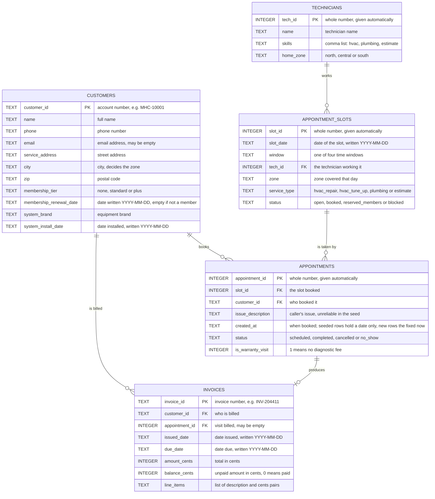

*The five provided tables: customers book appointments in technicians' slots and receive invoices.*

How the tables link, in words: each appointment belongs to exactly one customer and takes exactly one slot; each slot belongs to exactly one technician and may have several appointments over time (cancelled ones stay as history) but at most one with status scheduled, which the booking code enforces inside its transaction because the provided database has no such rule; each invoice belongs to exactly one customer and may refer to one appointment. The agent writes only to `appointment_slots.status`, `appointments`, and one small table it adds, `agent_confirmations` (confirmation id, result, time), which is written in the same transaction as each booking change so a repeated "yes" can never book twice; the provided tables are untouched and the nightly reset recreates `agent_confirmations` empty (architecture refinements (D36)). It never writes customers or invoices.

One made-up example row per table:

| Table | Example row |
|---|---|
| customers | MHC-10001 · Linda Foster · 512-555-0101 · linda@example.com · 12 Elm St · Round Rock · 78664 · standard · 2026-11-20 · Carrier · 2019-05-02 |
| technicians | 3 · Jun Park · hvac,plumbing · south |
| appointment_slots | 142 · 2026-10-22 · 08:00-12:00 · 1 · north · hvac_repair · booked |
| appointments | 160 · 142 · MHC-10001 · AC blowing warm · 2026-10-16T09:00 · scheduled · 0 |
| invoices | INV-204411 · MHC-10002 · 87 · 2026-10-01 · 2026-10-31 · 47800 · 47800 · diagnostic 8900, contactor 24500, after-hours 14400 |

### 4.2 Operations database (never reset)

A second SQLite file on the same disk, created by the app. It holds everything about how the agent behaves. Split into two diagrams to stay readable.

**Conversations and what happened in them:**

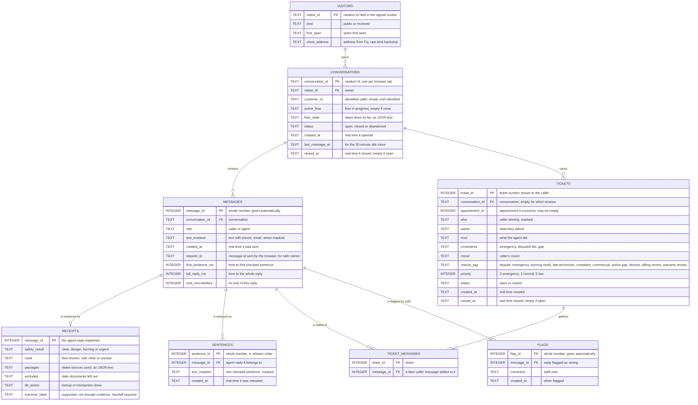

*Each visitor opens conversations; each message may carry a receipt; conversations raise tickets; staff flags point at single replies.*

How they link, in words: each conversation belongs to exactly one visitor; each message belongs to exactly one conversation; each agent message has at most one receipt and is saved as the checked sentences released for it, in order, which the stream replays after a reconnect; each ticket belongs to at most one conversation (silent billing-review tickets have none) and may refer to one appointment, and messages after a handoff stay in the same conversation and are linked to the ticket (ticket messages) so the ticket shows them; each flag points at exactly one agent message. Every query for a conversation, its messages, receipts or tickets filters by both the conversation id and the signed visitor id, unless the request carries a staff session.

| Table | Example row |
|---|---|
| visitors | v_8f3a · reviewer · 2026-10-20T14:02 · 203.0.113.7 |
| conversations | c_91d2 · v_8f3a · MHC-10002 · empty · {} · open · 2026-10-20T14:02 · 2026-10-20T14:09 · empty |
| messages | 5012 · c_91d2 · agent · "Your open balance is $478.00, due 31 October." · 2026-10-20T14:09 · m_77a · 1840 · 3200 · 3900 |
| receipts | 5012 · clear · account question, clear · [] · [] · invoice lookup MHC-10002 · supported |
| tickets | 12 · c_91d2 · 87 · Omar Patel, MHC-10002 · disputes after-hours fee · read invoice lines · disputed fee $144 · frustrated · dispute · 1 · open · 2026-10-20T14:10 · empty |
| flags | 3 · 5012 · "Should have mentioned due date earlier" · 2026-10-20T15:30 |

**Money, limits and jobs:**

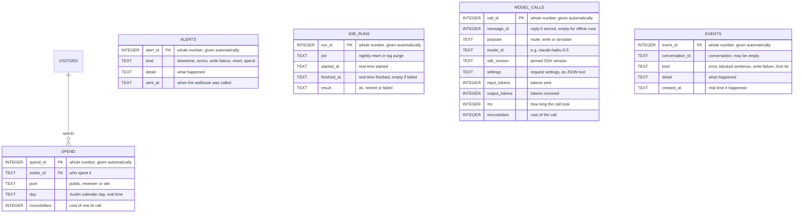

*Spending is recorded per AI call and summed per pool and day; model calls and events give the audit trail and the error alerts; confirmations live in the scheduling database beside the bookings they protect.*

How they link, in words: each spending row belongs to one visitor (site-level rows use a fixed visitor id); each model call may point at the reply it served; events name their conversation; alerts and job runs stand alone. Silent billing reviews and warranty-review notes are ordinary low-priority tickets, not a separate table. Rate-limit counts are kept in memory and rebuilt from the messages table after a restart.

| Table | Example row |
|---|---|
| spend | 88213 · v_8f3a · reviewer · 2026-10-20 · 4100 |
| alerts | 7 · spend · "daily spend passed $5.00" · 2026-10-20T16:44 |
| job_runs | 31 · nightly reset · 2026-10-21T03:00:00 · 2026-10-21T03:00:02 · ok |
| model_calls | 99120 · 5012 · write · claude-sonnet-5-5 · anthropic 1.4.2 · {"effort":"low"} · 2100 · 85 · 1650 · 3100 |
| events | 451 · c_91d2 · blocked sentence · "promised a waiver" · 2026-10-20T14:12 |

## 5. Request flows

### 5.1 A knowledge question

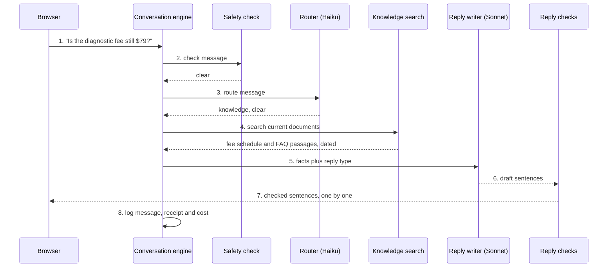

*How a fee question is answered from current documents only, with every sentence checked before it is shown.*

1. The browser sends the message as an ordinary request with its conversation id and a message id, and opens the sentence stream for that message id; the server checks the conversation belongs to the signed visitor.
2. The safety check runs in code; nothing matches.
3. Haiku 5.5 returns the route "knowledge" with the label "clear".
4. Combined search returns the top five pieces; the old $79 FAQ is not in the index at all, because the document list excludes it.
5. If the top piece's meaning-based score is below the chosen threshold, the engine goes to a handoff instead; here it is above, so the facts and a "price answer" reply type go to Sonnet 5.5.
6. Sonnet writes the reply, which must include the source and the "technician confirms the final price on site" line.
7. Each sentence is checked for promises, discounts, waivers and internal text, then released to the browser.
8. The message, its receipt (route, passages, excluded stale document), its model calls and its cost are written to the operations database.

### 5.2 A new booking

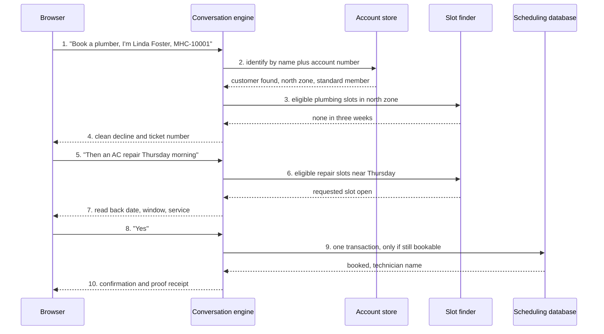

*How a booking is checked and written, including the common case where no slot exists.*

1. The caller asks to book and gives a name and account number.
2. The account store matches name plus account number (never a name alone); after two failed attempts it would hand off.
3. The slot finder asks for slots that are open, or members-only for standard or Plus members, in the caller's zone and service type, not yet started relative to the fixed "now", and whose technician has no overlapping booking.
4. The north zone has no plumbing slots, so the agent says so plainly and creates a ticket naming the gap: a clean decline.
5. The caller asks for an HVAC repair instead.
6. The finder offers the requested slot if eligible, otherwise up to three nearest by date then window.
7. The agent reads back the date, window and service type, with a confirmation id attached.
8. The caller confirms. A double click or a browser retry sends the same confirmation id, which returns the first result instead of booking twice (booking, reviewer-link and downtime protections (D34)).
9. One write-locked transaction reruns every eligibility check (slot status, zone, service, membership, not started, no overlapping booking for the technician, no other scheduled appointment on the slot), then marks the slot booked and adds the appointment row; if anything changed, the agent says the slot was just taken and offers the next three. The warranty-visit flag is set only if the install date proves the 2-year installation warranty; other warranty claims add a low-priority warranty-review ticket linked to the appointment. If the booking commits but the operations write then fails, the booking stands, the caller still gets the confirmation, the write is retried, and if it fails again the appointment id goes to the server log with an alert.
10. The agent confirms with the technician's name and a proof receipt ("customer verified · eligibility checked · booked in one transaction").

### 5.3 Rescheduling or cancelling

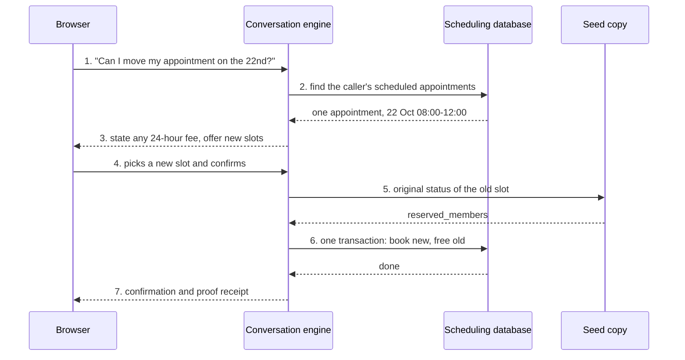

*How moving an appointment keeps the database consistent and restores the old slot correctly.*

1. The identified caller asks to move an appointment.
2. The engine reads the caller's scheduled appointments; if there are several it asks which one, reading back only date, window, service and technician.
3. If the window starts within 24 hours of "now", the agent states the $49 fee before the caller confirms; a waiver request would hand off.
4. The caller picks one of the offered slots and confirms.
5. The engine reads the old slot's status in the seed copy; if the seed shows it as booked (a seeded appointment), the slot will be freed to open.
6. One write-locked transaction rechecks the new slot's eligibility, books it, updates the appointment and returns the old slot to its seed status (here members-only, not open). Cancelling is the same without the new booking. Both carry a confirmation id, so a repeat returns the first result.
7. The agent confirms with a proof receipt.

### 5.4 An account question with a fee mismatch

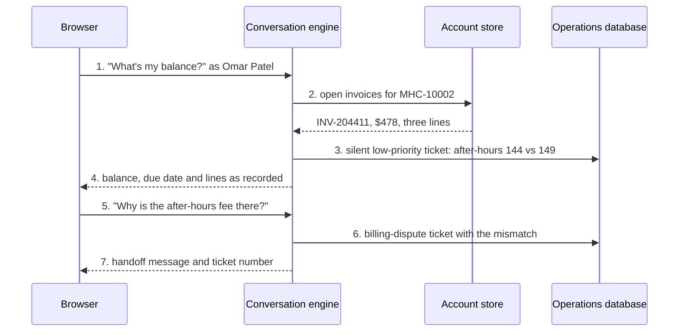

*How the agent reads an invoice exactly as recorded, quietly notes a fee mismatch for staff, and hands off only when the caller questions a charge.*

1. The identified caller asks for their balance.
2. The account store reads open invoices (read-only).
3. Code compares fixed-fee lines with the current schedule; the after-hours line is $144 against $149, so a low-priority ticket tagged "billing review" is saved silently for staff, with no conversation shown to the caller.
4. The agent reads the balance, due date and lines exactly as recorded, without judging them.
5. The caller questions a charge.
6. A billing-dispute ticket is created, with the mismatch written into its constraints field.
7. The caller is told a team member will contact them within one business day and sees the ticket number.

### 5.5 An emergency

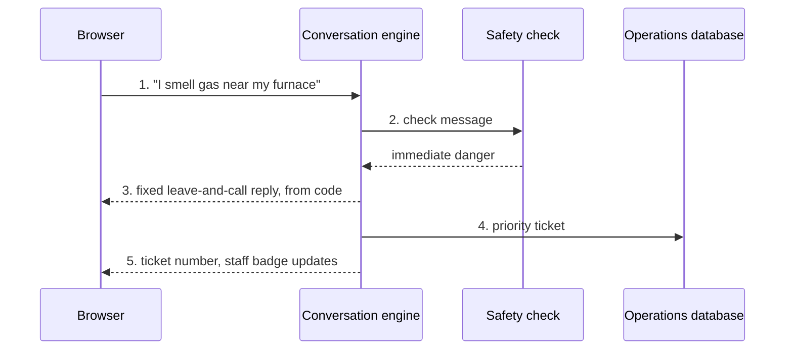

*How an emergency skips the router and the AI writer entirely.*

1. The caller reports a gas smell, even in the middle of a booking.
2. The safety check runs before any spending or rate limit, so even a visitor over budget gets this reply; it normalises spelling and speech-to-text errors and matches the immediate-danger class.
3. The fixed reply written in code tells them to leave the home and call 911 or the gas utility from outside, and not to flip switches or restart equipment. No AI model is involved.
4. A priority ticket is created; emergencies are never booked.
5. The caller sees the ticket number, and the Staff view badge shows a new priority ticket.

### 5.6 Staff view and flagging

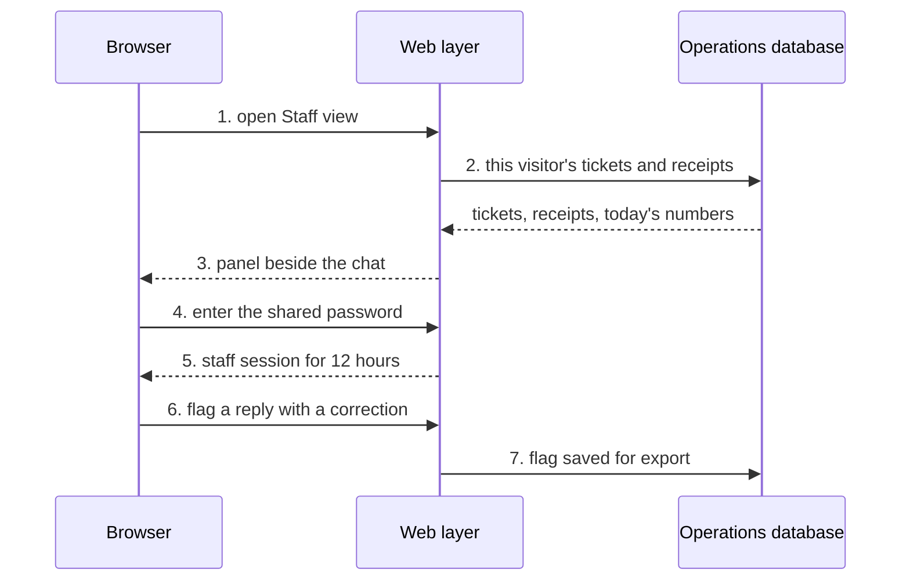

*How the Staff view shows only the visitor's own session until the shared password unlocks the full queue and flagging.*

1. The visitor opens the Staff view panel.
2. The web layer reads only tickets and receipts whose conversation belongs to the signed visitor, plus today's live numbers.
3. The panel opens beside the chat, which stays visible.
4. To see every visitor's queue or flag replies, the user enters the shared password.
5. A 12-hour staff session starts (see the login flow below).
6. The staff user flags a reply as wrong with a correction note.
7. The flag is saved and can be exported as a candidate test case.

### 5.7 An offline test run

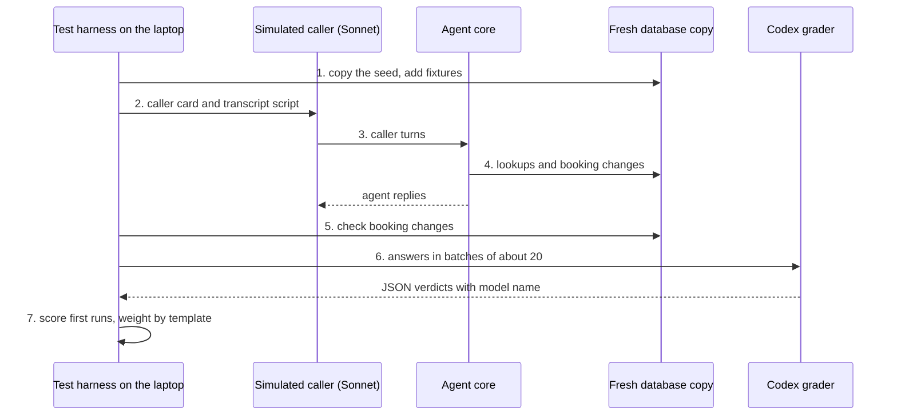

*How the held-out set is measured against a fresh database copy, never the live one.*

1. For each case the harness copies the seed database and adds its fixtures: the invoice the caller describes, a synthetic customer if no real one matches, and for an existing-appointment call with no matching seeded appointment (a customer whose only upcoming appointment is on that day, for the service the caller describes), that appointment: in an open seed slot, or a new slot for a technician free in that window. Planted rows use ids no seed row has: synthetic customers MHC-0xxxx, invoices INV-9xxxxx unless the caller names one, appointments from 5000 and slots from 9000; a planted row that collides fails rather than replacing a seed row.
2. Sonnet 5.5 plays the caller from the caller card and the transcript.
3. The caller's turns go to the same agent core the web app uses, called directly with no web layer.
4. The agent does its lookups and booking changes on the copy.
5. Code checks the database changes against the expected outcome.
6. Knowledge answers go to Codex in batches of about 20 for JSON verdicts; the author is told first so Codex is set to a frontier model.
7. The first run of each case is scored, failures are retried once and reported as flaky if they then pass, and containment is weighted by each template's call count.

## 6. User flow

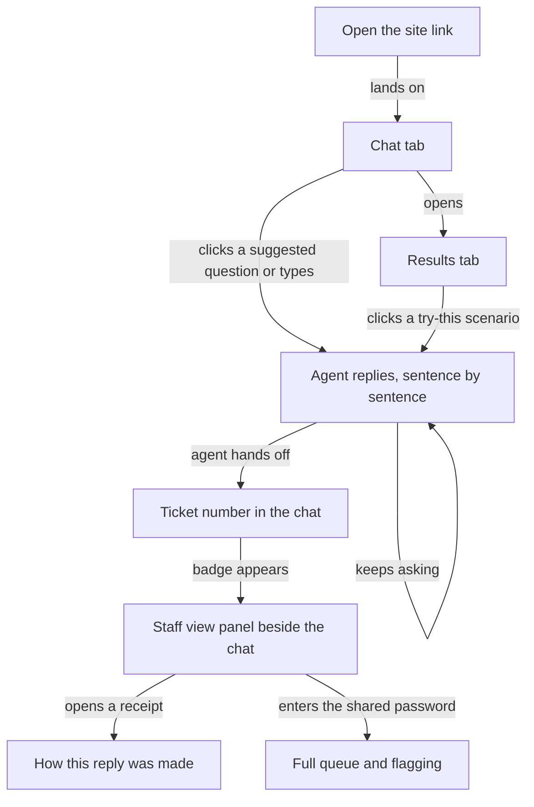

*The reviewer's path: start chatting, try the scenarios from Results, cause a handoff, then inspect the ticket and the reply receipts beside the chat.*

## 7. Login and permissions

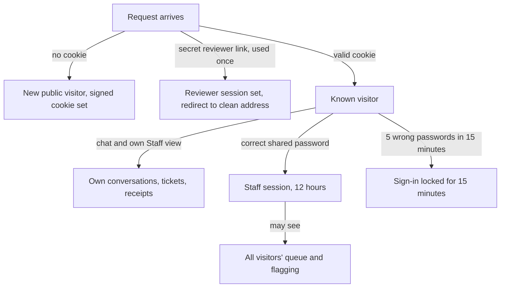

*Three levels of access: any visitor sees only their own session, the reviewer link adds a protected budget, and the shared password unlocks the full queue.*

The visitor cookie is signed, HttpOnly, Secure, SameSite=Lax and lasts 7 days. The reviewer link carries its token after a # (the fragment, which browsers never send to servers, so it never reaches Fly's or the app's request logs); the page sends it once in a request body, it is checked once, turned into a signed reviewer session with the reserve budget, and the browser is redirected to the plain address so the token never stays in the address bar, history or logs. The reviewer token and the hashed staff password are Fly.io secrets, never in the repository. The flag form carries a token against forged requests. Phone numbers, emails and street addresses are masked at every level.

## 8. States

### 8.1 Appointment slot status

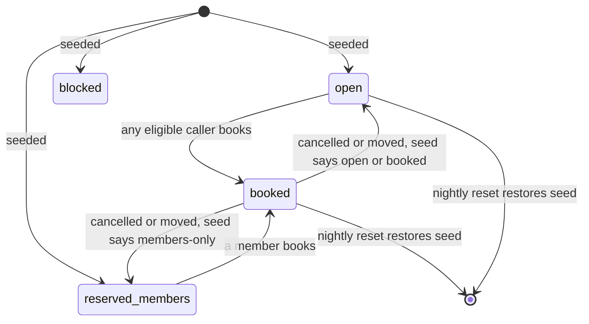

*A slot can only be booked from open or members-only; a freed slot returns to its seed status, or to open if the seed itself shows it booked; the nightly reset restores every slot.*

### 8.2 Conversation lifecycle

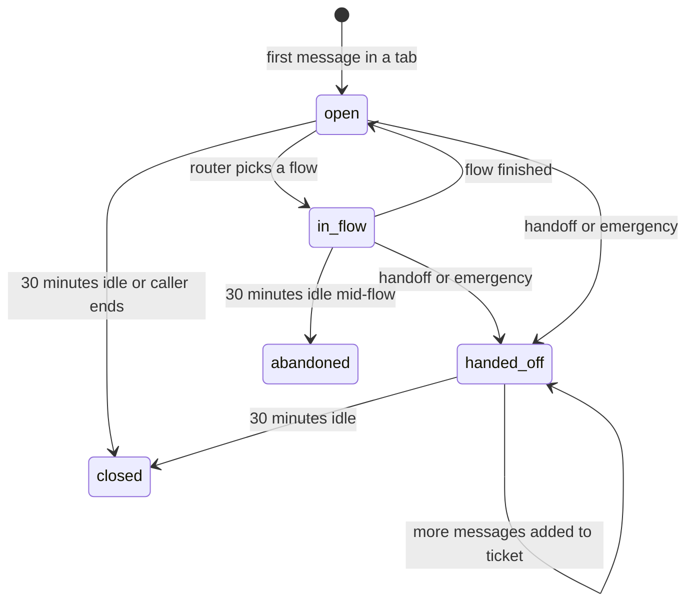

*Conversations stay open across follow-ups, keep adding to their ticket after a handoff, and close after 30 idle minutes; a conversation idle in the middle of a flow counts as abandoned for live containment.*

### 8.3 Ticket

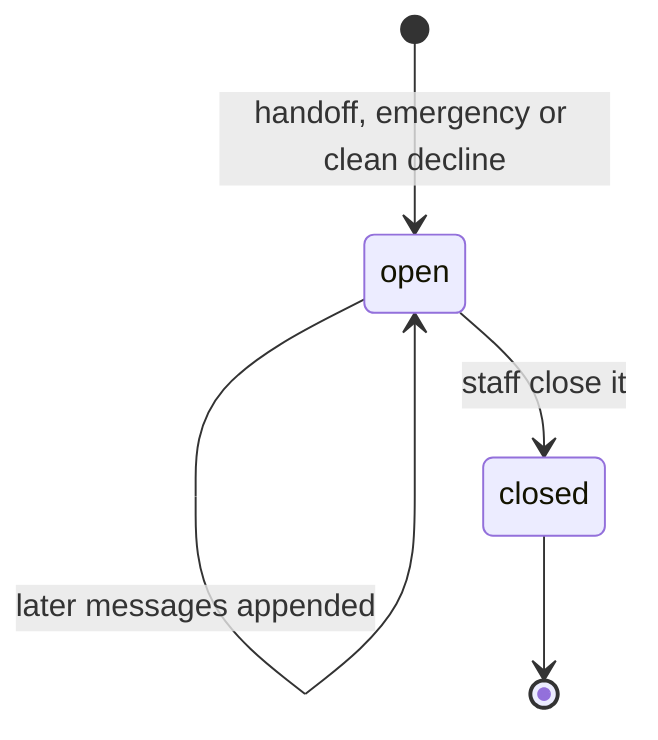

*Tickets open on any handoff, gather later messages, and are closed by staff.*

## 9. Data sent to outside services

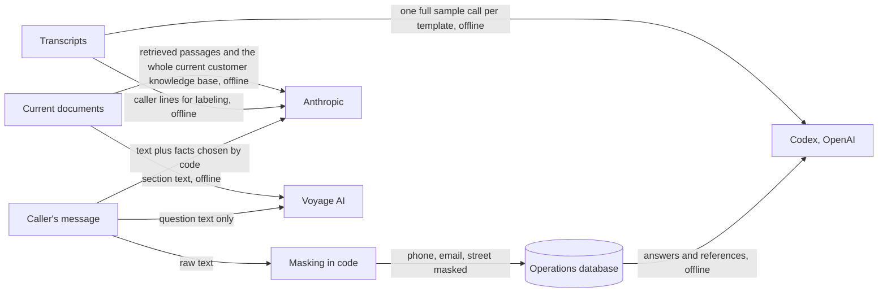

*What leaves the app: Anthropic sees the conversation and the facts code selected; Voyage sees questions and document sections; Codex sees transcripts and graded answers offline; logs keep only masked text.*

Anthropic receives the caller's own text (needed to understand and identify them) plus facts chosen by code; it never receives internal documents as written or database rows a flow does not need. All customer data is synthetic, but the habits are production ones: internal documents are never sent as written (only paraphrased rules), the model never receives database rows beyond the facts a flow needs, logs are masked and purged after 30 days, and keys live only in `.env` locally and Fly.io secrets in production.

## 10. Background jobs and alerts

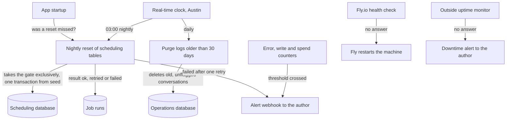

*Two scheduled jobs and the alerting paths; the reset waits for a lock, runs at startup if missed, and alerts after one failed retry.*

1. At 03:00 Austin time the reset takes the app-wide gate exclusively (every message handler holds it shared, so messages arriving meanwhile wait, and the reset waits for messages in progress to finish), replaces the scheduling tables from the seed copy in one transaction, records the run, and releases the gate.
2. If the app starts and the last successful reset is older than the most recent 03:00, the reset runs immediately.
3. A failed reset is retried once, then the author is alerted and the dashboard shows it.
4. The daily purge deletes conversations older than 30 days with their messages, receipts and model calls, except conversations with a flag, which are kept until exported.
5. Alerts fire on 3 or more errors in 10 minutes (or over 20 percent of at least 10 messages), any failed database write, a failed reset, and daily spend passing $5; Fly.io's health check restarts the machine if the health endpoint stops answering, and a free outside uptime monitor alerts the author about downtime, which the app cannot report while it is down.

## 11. Deployment

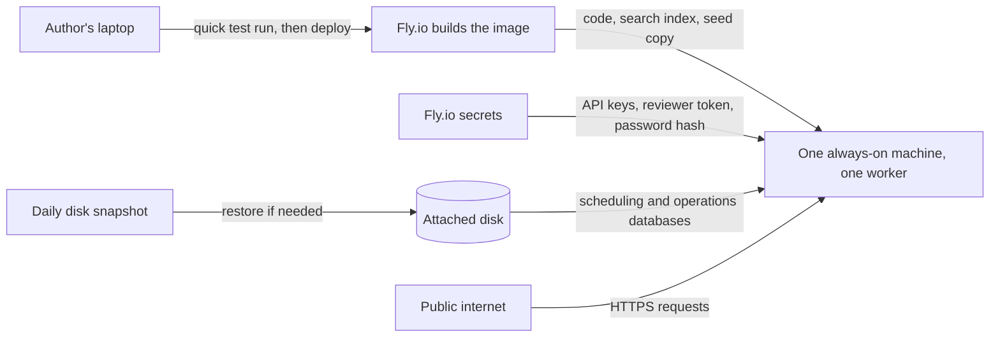

*One machine with one disk: each release carries the code, search index and seed copy, so rolling back a release rolls back prompts and index together.*

Rollback runbook (in the README, practised once): roll back to the previous Fly.io release; if data is damaged, restore the disk from the latest daily snapshot; the nightly reset rebuilds the scheduling data from the seed in any case.

## 12. Code structure

```mermaid
flowchart TB
    WEB["web: routes, pages, stream, staff auth"] -->|"calls"| CORE["core: conversation engine"]
    CORE -->|"calls"| SAFE["safety"]
    CORE -->|"calls"| ROUTE["routing"]
    CORE -->|"calls"| KNOW["knowledge"]
    CORE -->|"calls"| ACCT["accounts"]
    CORE -->|"calls"| SCHED["scheduling"]
    CORE -->|"calls"| HAND["handoff"]
    CORE -->|"calls"| REPLY["replies: writer and checks"]
    CORE -->|"records to"| OPS["ops: logs, limits, alerts, jobs"]
    EVAL["eval: harness, simulator, grader"] -->|"drives"| CORE
    PIPE["pipeline: templates, labels, index, findings"] -->|"produces data for"| KNOW
    PIPE -->|"uses the zone map and settings"| SCHED
```

*Every package depends on the core only through plain function calls; the offline evaluation drives the same core the web uses.*

| Folder | Contents |
|---|---|
| `app/web/` | Page routes, the chat stream, the Staff view, cookie and staff-password handling |
| `app/core/` | Conversation engine, conversation state, the pipeline order |
| `app/safety/` | Emergency patterns, normalisation, fixed safety replies |
| `app/routing/` | Haiku router call and its structured result |
| `app/knowledge/` | Index loading, keyword and meaning search, rank fusion keeping each list's top result, threshold |
| `app/accounts/` | Identity checks, invoice, membership and system lookups, fee-mismatch check |
| `app/scheduling/` | Slot eligibility, alternatives, booking, reschedule and cancel transactions, seed lookups |
| `app/handoff/` | Tickets, reason tags, appending later messages |
| `app/replies/` | Sonnet writer, reply types, sentence checks, internal-text match |
| `app/ops/` | Operations database, logging and masking, spending and rate limits, alerts, nightly reset, purge |
| `app/config.py` | Pinned model IDs, fixed "now", thresholds and limits |
| `pipeline/` | Transcript loading and template grouping (with families), Haiku, Codex and Fable labeling and the blind-third sheet, label agreement, staff policy-error checks, zone capacity counts, the document list, conflict register and format conversion, index build, and the findings document `docs/FINDINGS.md`; it uses the app's zone map (`app/scheduling/zones.py`) and settings |
| `eval/` | Test-set builder (caller cards, fixtures), simulator, Codex grader, metrics and reports |
| `data/` | Document list, conflict register, converted documents (`data/kb_text/`), the hand transcription of the holiday-hours image, templates, labels, built index, test set, results |
| `tests/` | Unit and flow tests run by `python -m pytest` |

## 13. Evaluation files

The test evidence is kept as versioned files in `data/`, so held-out isolation and scoring can be checked by anyone reading the repository.

| File | What it holds |
|---|---|
| `data/templates.csv` | Each call's template id, the template's call count, its family (a waitlist template shares its booking twin's family (template families (D39))), the normalised request and the staff outcome |
| `data/template_merges.csv` | The reviewed merge list |
| `data/labels_haiku.csv`, `data/labels_codex.csv`, `data/labels_fable.csv` | Haiku's call reason per call; Codex's per template (the reference) and Claude Fable 5.1's for the blind third (blind third labeled by Claude Fable 5.1 (D38)), each with its model name |
| `data/label_agreement.json` | Codex against Haiku and Fable against Codex, with any disagreements |
| `data/split.json` | The random seed, the working and held-out template lists, a hash of the held-out test cases recorded when they were frozen, and a status line saying when and why (refreezing the held-out cases (D40)) |
| `data/split_counts.csv` | Calls and templates per reason in the corpus, the working set and the held-out set |
| `data/testset/<case>.json` | One test case: template, family, reason and sub-reason, sample call, call weight, the caller script (rewritten with the caller card's identity), caller card (marked synthetic, and whether its zone came from the transcript or was drawn), the caller's existing appointment if any, fixtures, every request in the call with its own expected outcome, the overall expected outcome (contained, handed off, clean decline or redirect) and handoff reason, whether it needs documents, the reference answer and its evidence spans (converted file in `data/kb_text/`, heading, line range of exactly the answering lines), and what the agent must not do |
| `data/case_requests.csv` | The reviewed list of every request in each call beyond its labelled reason, quoting the caller's words, with its kind (knowledge, booking, action) and the reference it needs |
| `data/knowledge_questions.jsonl` | The retrieval questions (from the test cases, plus answerable, stale-trap and unanswerable ones written by hand), each with its set, whether it falls under a handled reason, its call weight (questions from test cases), reference answer and evidence spans |
| `data/results/retrieval/summary.json` | Retrieval measures for keyword-only, meaning-only and combined search on a named question set; coverage as the call-weighted share of the knowledge questions callers ask that the documents answer; the check that no excluded document is in the index; and the SDK versions, models, token, retry and timeout settings and spending cap used |
| `data/results/retrieval/answers_to_grade.jsonl` | Answers from keyword-only search, combined search and the whole knowledge base, with the model, for grading on answer correctness (stale-trap accuracy is judged here) |
| `data/results/<run>/attempts.jsonl` | One line per attempt: case, attempt number, first-run flag, conversation, database checks, model ids and settings, grader verdict and grader model |
| `data/results/<run>/summary.json` | The computed numbers and their intervals for that run |
| `data/grader_check.csv` | The pre-chosen sample, the author's blind grades and the grader's verdicts |

The held-out hash is recorded in git before any tuning; the final run checks the files still match it, and checks a second hash covering only the agent-behaviour files (core, routing, knowledge, accounts, scheduling, safety, replies, handoff, thresholds, prompts and the search index) recorded at the day-3 freeze, so web, operations and deployment code may still change. Paid test runs are capped at 12 caller turns per conversation, fixed output-token limits, 60 seconds per conversation, one retry, a separate test key, and an $8 stop per run.

## 14. Diagrams added or skipped

- System overview, main parts, both database diagrams, seven request flows and the user flow: always drawn.
- Login and permissions: added, because of the visitor cookie, reviewer link and staff password.
- State diagrams: added for slot status, conversation lifecycle and tickets, which all change over time.
- Data flow: added, because text goes to Anthropic, Voyage and Codex.
- Background jobs: added, for the nightly reset, log purge and alerts.
- Deployment: added, for the Fly.io machine, disk, secrets and snapshots.
- Code structure: added, because there are more than five packages.
- API map: skipped, because no separate front end or outside system calls the app; the pages and the chat stream are served by the same app.
- Business process: skipped as a separate diagram; the handoff to staff is shown in the Staff view flow and the ticket states.

## 15. Trade-offs and what to revisit

- **One machine, one worker.** Simple and enough for a demo; a real deployment would need a second machine and a scheduler outside the web process.
- **SQLite.** Matches the provided data and keeps everything on one disk; many simultaneous writers would need a server database.
- **Index shipped in the release.** Rebuilding the index means a new release, which is fine for 17 documents and makes rollback complete; a large, often-edited knowledge base would need a separate index service.
- **Sentence-by-sentence release.** Safer than word-by-word streaming, at the cost of about a second before the first words appear.
- **Fixed patterns for safety.** Predictable and testable, but they need the adversarial set to cover paraphrases and speech-to-text errors.

## Glossary

- **Web application:** the program that serves the pages and answers chat messages.
- **FastAPI:** a Python framework for building web applications.
- **Worker process:** one running copy of the web application handling requests.
- **Server-sent events:** a way for a server to keep pushing text to a browser over one open connection.
- **SQLite:** a database stored in a single file, with no separate database server.
- **Write-ahead logging:** a SQLite mode that lets reads continue while a write is happening.
- **Seed copy:** an untouched copy of the original scheduling database used for the nightly reset and to restore slots.
- **Operations database:** the second database holding logs, tickets, costs and job records.
- **Transaction:** a group of database changes that all happen together or not at all.
- **Router:** the step that decides which flow a message belongs to.
- **Flow:** a conversation path with fixed steps and rules enforced in code.
- **Reply type:** a fixed shape for a reply (such as a price answer or a booking confirmation) that the writer must fill.
- **Reciprocal-rank fusion:** a way to merge two ranked result lists by giving each item points based on its position in each list.
- **Embedding:** a list of numbers representing a text's meaning, used for meaning-based search.
- **Receipt:** the stored explanation of how a reply was made.
- **Ticket:** the record of a handed-off conversation for staff.
- **Signed cookie:** a small browser-stored value the server can verify was not altered.
- **HttpOnly, Secure, SameSite:** cookie settings that hide it from page scripts, send it only over HTTPS, and limit it to this site.
- **Forged request:** a request another site tricks a logged-in browser into sending; a form token blocks it.
- **Webhook:** a web address the app calls to deliver a message, such as an alert.
- **Health endpoint:** a web address the host checks regularly to confirm the app is alive.
- **Fly.io secret:** a setting such as a key stored by the host, not in the code.
- **Disk snapshot:** a saved copy of the attached disk that can be restored.
- **Release:** one deployed version of the app; rolling back returns to the previous release.
- **Fixture:** prepared test data added to a database copy for one test case.
- **Simulated caller:** an AI playing the customer in a test conversation.
- **Template:** a call pattern repeated across many transcripts with only details changed.
- **Masking:** replacing phone numbers, emails and street addresses with placeholders.
- **Microdollar:** one millionth of a dollar, used to add up small AI costs exactly.
- **Reset gate:** a lock inside the app that every message holds briefly and the nightly reset holds alone, so they never overlap.
- **Confirmation id:** a one-time id attached to a read-back so a repeated "yes" cannot book twice.
- **Uptime monitor:** an outside service that regularly checks the site and alerts when it stops answering.
- **Hash:** a short fingerprint of a file; if the file changes, the fingerprint changes.
